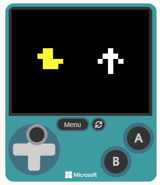
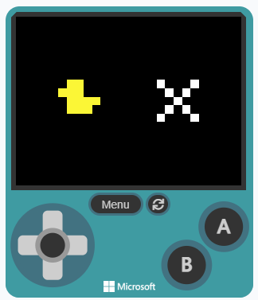
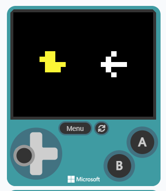
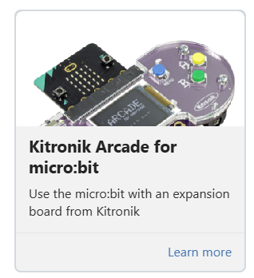

### @title Battle Bot 2: Arcade Controller

### @description Swap the micro:bit remote for an Arcade controller - more buttons, more moves.

### @preferredEditor blocks

### @explicitHints true

# Battle Bot 2: Arcade Controller

```package
radio
```

```template
let REVERSE = 0
let FORWARD = 0
let STOP = 0
let SPIN_RIGHT = 0
let SPIN_LEFT = 0
let duck: Image = null
let heart: Image = null
let ghost: Image = null
let rabbit: Image = null
let giraffe: Image = null
let snake: Image = null
let arrowUp: Image = null
let arrowDown: Image = null
let arrowLeft: Image = null
let arrowRight: Image = null
let stopSign: Image = null
let channel = ""
// CHANGE THIS: the SAME icon name as your robot, e.g. duck
channel = "duck"
// CHANGE THIS: the SAME group number as your robot
radio.setGroup(101)
SPIN_LEFT = 0
SPIN_RIGHT = 1
STOP = 2
FORWARD = 3
REVERSE = 4
scene.setBackgroundColor(15)
setupPictures()
let bot = sprites.create(duck, SpriteKind.Player)
bot.setPosition(45, 60)
let arrow = sprites.create(stopSign, SpriteKind.Player)
arrow.setPosition(115, 60)
// Ready-made pictures - no need to change these
function setupPictures () {
    duck = img`
        . . . . . . . . . . . . . . . . . . . . . . . . . . . . . . . .
        . . . . . . . 5 5 5 5 5 5 5 5 5 5 5 5 . . . . . . . . . . . . .
        . . . . . . . 5 5 5 5 5 5 5 5 5 5 5 5 . . . . . . . . . . . . .
        . . . . . . . 5 5 5 5 5 5 5 5 5 5 5 5 . . . . . . . . . . . . .
        . . . . . . . 5 5 5 5 5 5 5 5 5 5 5 5 . . . . . . . . . . . . .
        . . . . . . . 5 5 5 5 5 5 5 5 5 5 5 5 . . . . . . . . . . . . .
        . . . . . . . 5 5 5 5 5 5 5 5 5 5 5 5 . . . . . . . . . . . . .
        . 5 5 5 5 5 5 5 5 5 5 5 5 5 5 5 5 5 5 . . . . . . . . . . . . .
        . 5 5 5 5 5 5 5 5 5 5 5 5 5 5 5 5 5 5 . . . . . . . . . . . . .
        . 5 5 5 5 5 5 5 5 5 5 5 5 5 5 5 5 5 5 . . . . . . . . . . . . .
        . 5 5 5 5 5 5 5 5 5 5 5 5 5 5 5 5 5 5 . . . . . . . . . . . . .
        . 5 5 5 5 5 5 5 5 5 5 5 5 5 5 5 5 5 5 . . . . . . . . . . . . .
        . 5 5 5 5 5 5 5 5 5 5 5 5 5 5 5 5 5 5 . . . . . . . . . . . . .
        . . . . . . . 5 5 5 5 5 5 5 5 5 5 5 5 5 5 5 5 5 5 5 5 5 5 5 5 .
        . . . . . . . 5 5 5 5 5 5 5 5 5 5 5 5 5 5 5 5 5 5 5 5 5 5 5 5 .
        . . . . . . . 5 5 5 5 5 5 5 5 5 5 5 5 5 5 5 5 5 5 5 5 5 5 5 5 .
        . . . . . . . 5 5 5 5 5 5 5 5 5 5 5 5 5 5 5 5 5 5 5 5 5 5 5 5 .
        . . . . . . . 5 5 5 5 5 5 5 5 5 5 5 5 5 5 5 5 5 5 5 5 5 5 5 5 .
        . . . . . . . 5 5 5 5 5 5 5 5 5 5 5 5 5 5 5 5 5 5 5 5 5 5 5 5 .
        . . . . . . . 5 5 5 5 5 5 5 5 5 5 5 5 5 5 5 5 5 5 . . . . . . .
        . . . . . . . 5 5 5 5 5 5 5 5 5 5 5 5 5 5 5 5 5 5 . . . . . . .
        . . . . . . . 5 5 5 5 5 5 5 5 5 5 5 5 5 5 5 5 5 5 . . . . . . .
        . . . . . . . 5 5 5 5 5 5 5 5 5 5 5 5 5 5 5 5 5 5 . . . . . . .
        . . . . . . . 5 5 5 5 5 5 5 5 5 5 5 5 5 5 5 5 5 5 . . . . . . .
        . . . . . . . 5 5 5 5 5 5 5 5 5 5 5 5 5 5 5 5 5 5 . . . . . . .
        . . . . . . . . . . . . . . . . . . . . . . . . . . . . . . . .
        . . . . . . . . . . . . . . . . . . . . . . . . . . . . . . . .
        . . . . . . . . . . . . . . . . . . . . . . . . . . . . . . . .
        . . . . . . . . . . . . . . . . . . . . . . . . . . . . . . . .
        . . . . . . . . . . . . . . . . . . . . . . . . . . . . . . . .
        . . . . . . . . . . . . . . . . . . . . . . . . . . . . . . . .
        . . . . . . . . . . . . . . . . . . . . . . . . . . . . . . . .
        `
    heart = img`
        . . . . . . . . . . . . . . . . . . . . . . . . . . . . . . . .
        . . . . . . . 3 3 3 3 3 3 . . . . . . 3 3 3 3 3 3 . . . . . . .
        . . . . . . . 3 3 3 3 3 3 . . . . . . 3 3 3 3 3 3 . . . . . . .
        . . . . . . . 3 3 3 3 3 3 . . . . . . 3 3 3 3 3 3 . . . . . . .
        . . . . . . . 3 3 3 3 3 3 . . . . . . 3 3 3 3 3 3 . . . . . . .
        . . . . . . . 3 3 3 3 3 3 . . . . . . 3 3 3 3 3 3 . . . . . . .
        . . . . . . . 3 3 3 3 3 3 . . . . . . 3 3 3 3 3 3 . . . . . . .
        . 3 3 3 3 3 3 3 3 3 3 3 3 3 3 3 3 3 3 3 3 3 3 3 3 3 3 3 3 3 3 .
        . 3 3 3 3 3 3 3 3 3 3 3 3 3 3 3 3 3 3 3 3 3 3 3 3 3 3 3 3 3 3 .
        . 3 3 3 3 3 3 3 3 3 3 3 3 3 3 3 3 3 3 3 3 3 3 3 3 3 3 3 3 3 3 .
        . 3 3 3 3 3 3 3 3 3 3 3 3 3 3 3 3 3 3 3 3 3 3 3 3 3 3 3 3 3 3 .
        . 3 3 3 3 3 3 3 3 3 3 3 3 3 3 3 3 3 3 3 3 3 3 3 3 3 3 3 3 3 3 .
        . 3 3 3 3 3 3 3 3 3 3 3 3 3 3 3 3 3 3 3 3 3 3 3 3 3 3 3 3 3 3 .
        . 3 3 3 3 3 3 3 3 3 3 3 3 3 3 3 3 3 3 3 3 3 3 3 3 3 3 3 3 3 3 .
        . 3 3 3 3 3 3 3 3 3 3 3 3 3 3 3 3 3 3 3 3 3 3 3 3 3 3 3 3 3 3 .
        . 3 3 3 3 3 3 3 3 3 3 3 3 3 3 3 3 3 3 3 3 3 3 3 3 3 3 3 3 3 3 .
        . 3 3 3 3 3 3 3 3 3 3 3 3 3 3 3 3 3 3 3 3 3 3 3 3 3 3 3 3 3 3 .
        . 3 3 3 3 3 3 3 3 3 3 3 3 3 3 3 3 3 3 3 3 3 3 3 3 3 3 3 3 3 3 .
        . 3 3 3 3 3 3 3 3 3 3 3 3 3 3 3 3 3 3 3 3 3 3 3 3 3 3 3 3 3 3 .
        . . . . . . . 3 3 3 3 3 3 3 3 3 3 3 3 3 3 3 3 3 3 . . . . . . .
        . . . . . . . 3 3 3 3 3 3 3 3 3 3 3 3 3 3 3 3 3 3 . . . . . . .
        . . . . . . . 3 3 3 3 3 3 3 3 3 3 3 3 3 3 3 3 3 3 . . . . . . .
        . . . . . . . 3 3 3 3 3 3 3 3 3 3 3 3 3 3 3 3 3 3 . . . . . . .
        . . . . . . . 3 3 3 3 3 3 3 3 3 3 3 3 3 3 3 3 3 3 . . . . . . .
        . . . . . . . 3 3 3 3 3 3 3 3 3 3 3 3 3 3 3 3 3 3 . . . . . . .
        . . . . . . . . . . . . . 3 3 3 3 3 3 . . . . . . . . . . . . .
        . . . . . . . . . . . . . 3 3 3 3 3 3 . . . . . . . . . . . . .
        . . . . . . . . . . . . . 3 3 3 3 3 3 . . . . . . . . . . . . .
        . . . . . . . . . . . . . 3 3 3 3 3 3 . . . . . . . . . . . . .
        . . . . . . . . . . . . . 3 3 3 3 3 3 . . . . . . . . . . . . .
        . . . . . . . . . . . . . 3 3 3 3 3 3 . . . . . . . . . . . . .
        . . . . . . . . . . . . . . . . . . . . . . . . . . . . . . . .
        `
    ghost = img`
        . . . . . . . . . . . . . . . . . . . . . . . . . . . . . . . .
        . 1 1 1 1 1 1 1 1 1 1 1 1 1 1 1 1 1 1 1 1 1 1 1 1 1 1 1 1 1 1 .
        . 1 1 1 1 1 1 1 1 1 1 1 1 1 1 1 1 1 1 1 1 1 1 1 1 1 1 1 1 1 1 .
        . 1 1 1 1 1 1 1 1 1 1 1 1 1 1 1 1 1 1 1 1 1 1 1 1 1 1 1 1 1 1 .
        . 1 1 1 1 1 1 1 1 1 1 1 1 1 1 1 1 1 1 1 1 1 1 1 1 1 1 1 1 1 1 .
        . 1 1 1 1 1 1 1 1 1 1 1 1 1 1 1 1 1 1 1 1 1 1 1 1 1 1 1 1 1 1 .
        . 1 1 1 1 1 1 1 1 1 1 1 1 1 1 1 1 1 1 1 1 1 1 1 1 1 1 1 1 1 1 .
        . 1 1 1 1 1 1 . . . . . . 1 1 1 1 1 1 . . . . . . 1 1 1 1 1 1 .
        . 1 1 1 1 1 1 . . . . . . 1 1 1 1 1 1 . . . . . . 1 1 1 1 1 1 .
        . 1 1 1 1 1 1 . . . . . . 1 1 1 1 1 1 . . . . . . 1 1 1 1 1 1 .
        . 1 1 1 1 1 1 . . . . . . 1 1 1 1 1 1 . . . . . . 1 1 1 1 1 1 .
        . 1 1 1 1 1 1 . . . . . . 1 1 1 1 1 1 . . . . . . 1 1 1 1 1 1 .
        . 1 1 1 1 1 1 . . . . . . 1 1 1 1 1 1 . . . . . . 1 1 1 1 1 1 .
        . 1 1 1 1 1 1 1 1 1 1 1 1 1 1 1 1 1 1 1 1 1 1 1 1 1 1 1 1 1 1 .
        . 1 1 1 1 1 1 1 1 1 1 1 1 1 1 1 1 1 1 1 1 1 1 1 1 1 1 1 1 1 1 .
        . 1 1 1 1 1 1 1 1 1 1 1 1 1 1 1 1 1 1 1 1 1 1 1 1 1 1 1 1 1 1 .
        . 1 1 1 1 1 1 1 1 1 1 1 1 1 1 1 1 1 1 1 1 1 1 1 1 1 1 1 1 1 1 .
        . 1 1 1 1 1 1 1 1 1 1 1 1 1 1 1 1 1 1 1 1 1 1 1 1 1 1 1 1 1 1 .
        . 1 1 1 1 1 1 1 1 1 1 1 1 1 1 1 1 1 1 1 1 1 1 1 1 1 1 1 1 1 1 .
        . 1 1 1 1 1 1 1 1 1 1 1 1 1 1 1 1 1 1 1 1 1 1 1 1 1 1 1 1 1 1 .
        . 1 1 1 1 1 1 1 1 1 1 1 1 1 1 1 1 1 1 1 1 1 1 1 1 1 1 1 1 1 1 .
        . 1 1 1 1 1 1 1 1 1 1 1 1 1 1 1 1 1 1 1 1 1 1 1 1 1 1 1 1 1 1 .
        . 1 1 1 1 1 1 1 1 1 1 1 1 1 1 1 1 1 1 1 1 1 1 1 1 1 1 1 1 1 1 .
        . 1 1 1 1 1 1 1 1 1 1 1 1 1 1 1 1 1 1 1 1 1 1 1 1 1 1 1 1 1 1 .
        . 1 1 1 1 1 1 1 1 1 1 1 1 1 1 1 1 1 1 1 1 1 1 1 1 1 1 1 1 1 1 .
        . 1 1 1 1 1 1 . . . . . . 1 1 1 1 1 1 . . . . . . 1 1 1 1 1 1 .
        . 1 1 1 1 1 1 . . . . . . 1 1 1 1 1 1 . . . . . . 1 1 1 1 1 1 .
        . 1 1 1 1 1 1 . . . . . . 1 1 1 1 1 1 . . . . . . 1 1 1 1 1 1 .
        . 1 1 1 1 1 1 . . . . . . 1 1 1 1 1 1 . . . . . . 1 1 1 1 1 1 .
        . 1 1 1 1 1 1 . . . . . . 1 1 1 1 1 1 . . . . . . 1 1 1 1 1 1 .
        . 1 1 1 1 1 1 . . . . . . 1 1 1 1 1 1 . . . . . . 1 1 1 1 1 1 .
        . . . . . . . . . . . . . . . . . . . . . . . . . . . . . . . .
        `
    rabbit = img`
        . . . . . . . . . . . . . . . . . . . . . . . . . . . . . . . .
        . 3 3 3 3 3 3 . . . . . . 3 3 3 3 3 3 . . . . . . . . . . . . .
        . 3 3 3 3 3 3 . . . . . . 3 3 3 3 3 3 . . . . . . . . . . . . .
        . 3 3 3 3 3 3 . . . . . . 3 3 3 3 3 3 . . . . . . . . . . . . .
        . 3 3 3 3 3 3 . . . . . . 3 3 3 3 3 3 . . . . . . . . . . . . .
        . 3 3 3 3 3 3 . . . . . . 3 3 3 3 3 3 . . . . . . . . . . . . .
        . 3 3 3 3 3 3 . . . . . . 3 3 3 3 3 3 . . . . . . . . . . . . .
        . 3 3 3 3 3 3 . . . . . . 3 3 3 3 3 3 . . . . . . . . . . . . .
        . 3 3 3 3 3 3 . . . . . . 3 3 3 3 3 3 . . . . . . . . . . . . .
        . 3 3 3 3 3 3 . . . . . . 3 3 3 3 3 3 . . . . . . . . . . . . .
        . 3 3 3 3 3 3 . . . . . . 3 3 3 3 3 3 . . . . . . . . . . . . .
        . 3 3 3 3 3 3 . . . . . . 3 3 3 3 3 3 . . . . . . . . . . . . .
        . 3 3 3 3 3 3 . . . . . . 3 3 3 3 3 3 . . . . . . . . . . . . .
        . 3 3 3 3 3 3 3 3 3 3 3 3 3 3 3 3 3 3 3 3 3 3 3 3 . . . . . . .
        . 3 3 3 3 3 3 3 3 3 3 3 3 3 3 3 3 3 3 3 3 3 3 3 3 . . . . . . .
        . 3 3 3 3 3 3 3 3 3 3 3 3 3 3 3 3 3 3 3 3 3 3 3 3 . . . . . . .
        . 3 3 3 3 3 3 3 3 3 3 3 3 3 3 3 3 3 3 3 3 3 3 3 3 . . . . . . .
        . 3 3 3 3 3 3 3 3 3 3 3 3 3 3 3 3 3 3 3 3 3 3 3 3 . . . . . . .
        . 3 3 3 3 3 3 3 3 3 3 3 3 3 3 3 3 3 3 3 3 3 3 3 3 . . . . . . .
        . 3 3 3 3 3 3 3 3 3 3 3 3 . . . . . . 3 3 3 3 3 3 . . . . . . .
        . 3 3 3 3 3 3 3 3 3 3 3 3 . . . . . . 3 3 3 3 3 3 . . . . . . .
        . 3 3 3 3 3 3 3 3 3 3 3 3 . . . . . . 3 3 3 3 3 3 . . . . . . .
        . 3 3 3 3 3 3 3 3 3 3 3 3 . . . . . . 3 3 3 3 3 3 . . . . . . .
        . 3 3 3 3 3 3 3 3 3 3 3 3 . . . . . . 3 3 3 3 3 3 . . . . . . .
        . 3 3 3 3 3 3 3 3 3 3 3 3 . . . . . . 3 3 3 3 3 3 . . . . . . .
        . 3 3 3 3 3 3 3 3 3 3 3 3 3 3 3 3 3 3 3 3 3 3 3 3 . . . . . . .
        . 3 3 3 3 3 3 3 3 3 3 3 3 3 3 3 3 3 3 3 3 3 3 3 3 . . . . . . .
        . 3 3 3 3 3 3 3 3 3 3 3 3 3 3 3 3 3 3 3 3 3 3 3 3 . . . . . . .
        . 3 3 3 3 3 3 3 3 3 3 3 3 3 3 3 3 3 3 3 3 3 3 3 3 . . . . . . .
        . 3 3 3 3 3 3 3 3 3 3 3 3 3 3 3 3 3 3 3 3 3 3 3 3 . . . . . . .
        . 3 3 3 3 3 3 3 3 3 3 3 3 3 3 3 3 3 3 3 3 3 3 3 3 . . . . . . .
        . . . . . . . . . . . . . . . . . . . . . . . . . . . . . . . .
        `
    giraffe = img`
        . . . . . . . . . . . . . . . . . . . . . . . . . . . . . . . .
        . 4 4 4 4 4 4 4 4 4 4 4 4 . . . . . . . . . . . . . . . . . . .
        . 4 4 4 4 4 4 4 4 4 4 4 4 . . . . . . . . . . . . . . . . . . .
        . 4 4 4 4 4 4 4 4 4 4 4 4 . . . . . . . . . . . . . . . . . . .
        . 4 4 4 4 4 4 4 4 4 4 4 4 . . . . . . . . . . . . . . . . . . .
        . 4 4 4 4 4 4 4 4 4 4 4 4 . . . . . . . . . . . . . . . . . . .
        . 4 4 4 4 4 4 4 4 4 4 4 4 . . . . . . . . . . . . . . . . . . .
        . . . . . . . 4 4 4 4 4 4 . . . . . . . . . . . . . . . . . . .
        . . . . . . . 4 4 4 4 4 4 . . . . . . . . . . . . . . . . . . .
        . . . . . . . 4 4 4 4 4 4 . . . . . . . . . . . . . . . . . . .
        . . . . . . . 4 4 4 4 4 4 . . . . . . . . . . . . . . . . . . .
        . . . . . . . 4 4 4 4 4 4 . . . . . . . . . . . . . . . . . . .
        . . . . . . . 4 4 4 4 4 4 . . . . . . . . . . . . . . . . . . .
        . . . . . . . 4 4 4 4 4 4 . . . . . . . . . . . . . . . . . . .
        . . . . . . . 4 4 4 4 4 4 . . . . . . . . . . . . . . . . . . .
        . . . . . . . 4 4 4 4 4 4 . . . . . . . . . . . . . . . . . . .
        . . . . . . . 4 4 4 4 4 4 . . . . . . . . . . . . . . . . . . .
        . . . . . . . 4 4 4 4 4 4 . . . . . . . . . . . . . . . . . . .
        . . . . . . . 4 4 4 4 4 4 . . . . . . . . . . . . . . . . . . .
        . . . . . . . 4 4 4 4 4 4 4 4 4 4 4 4 4 4 4 4 4 4 . . . . . . .
        . . . . . . . 4 4 4 4 4 4 4 4 4 4 4 4 4 4 4 4 4 4 . . . . . . .
        . . . . . . . 4 4 4 4 4 4 4 4 4 4 4 4 4 4 4 4 4 4 . . . . . . .
        . . . . . . . 4 4 4 4 4 4 4 4 4 4 4 4 4 4 4 4 4 4 . . . . . . .
        . . . . . . . 4 4 4 4 4 4 4 4 4 4 4 4 4 4 4 4 4 4 . . . . . . .
        . . . . . . . 4 4 4 4 4 4 4 4 4 4 4 4 4 4 4 4 4 4 . . . . . . .
        . . . . . . . 4 4 4 4 4 4 . . . . . . 4 4 4 4 4 4 . . . . . . .
        . . . . . . . 4 4 4 4 4 4 . . . . . . 4 4 4 4 4 4 . . . . . . .
        . . . . . . . 4 4 4 4 4 4 . . . . . . 4 4 4 4 4 4 . . . . . . .
        . . . . . . . 4 4 4 4 4 4 . . . . . . 4 4 4 4 4 4 . . . . . . .
        . . . . . . . 4 4 4 4 4 4 . . . . . . 4 4 4 4 4 4 . . . . . . .
        . . . . . . . 4 4 4 4 4 4 . . . . . . 4 4 4 4 4 4 . . . . . . .
        . . . . . . . . . . . . . . . . . . . . . . . . . . . . . . . .
        `
    snake = img`
        . . . . . . . . . . . . . . . . . . . . . . . . . . . . . . . .
        . 7 7 7 7 7 7 7 7 7 7 7 7 . . . . . . . . . . . . . . . . . . .
        . 7 7 7 7 7 7 7 7 7 7 7 7 . . . . . . . . . . . . . . . . . . .
        . 7 7 7 7 7 7 7 7 7 7 7 7 . . . . . . . . . . . . . . . . . . .
        . 7 7 7 7 7 7 7 7 7 7 7 7 . . . . . . . . . . . . . . . . . . .
        . 7 7 7 7 7 7 7 7 7 7 7 7 . . . . . . . . . . . . . . . . . . .
        . 7 7 7 7 7 7 7 7 7 7 7 7 . . . . . . . . . . . . . . . . . . .
        . 7 7 7 7 7 7 7 7 7 7 7 7 . . . . . . 7 7 7 7 7 7 7 7 7 7 7 7 .
        . 7 7 7 7 7 7 7 7 7 7 7 7 . . . . . . 7 7 7 7 7 7 7 7 7 7 7 7 .
        . 7 7 7 7 7 7 7 7 7 7 7 7 . . . . . . 7 7 7 7 7 7 7 7 7 7 7 7 .
        . 7 7 7 7 7 7 7 7 7 7 7 7 . . . . . . 7 7 7 7 7 7 7 7 7 7 7 7 .
        . 7 7 7 7 7 7 7 7 7 7 7 7 . . . . . . 7 7 7 7 7 7 7 7 7 7 7 7 .
        . 7 7 7 7 7 7 7 7 7 7 7 7 . . . . . . 7 7 7 7 7 7 7 7 7 7 7 7 .
        . . . . . . . 7 7 7 7 7 7 . . . . . . 7 7 7 7 7 7 . . . . . . .
        . . . . . . . 7 7 7 7 7 7 . . . . . . 7 7 7 7 7 7 . . . . . . .
        . . . . . . . 7 7 7 7 7 7 . . . . . . 7 7 7 7 7 7 . . . . . . .
        . . . . . . . 7 7 7 7 7 7 . . . . . . 7 7 7 7 7 7 . . . . . . .
        . . . . . . . 7 7 7 7 7 7 . . . . . . 7 7 7 7 7 7 . . . . . . .
        . . . . . . . 7 7 7 7 7 7 . . . . . . 7 7 7 7 7 7 . . . . . . .
        . . . . . . . 7 7 7 7 7 7 7 7 7 7 7 7 7 7 7 7 7 7 . . . . . . .
        . . . . . . . 7 7 7 7 7 7 7 7 7 7 7 7 7 7 7 7 7 7 . . . . . . .
        . . . . . . . 7 7 7 7 7 7 7 7 7 7 7 7 7 7 7 7 7 7 . . . . . . .
        . . . . . . . 7 7 7 7 7 7 7 7 7 7 7 7 7 7 7 7 7 7 . . . . . . .
        . . . . . . . 7 7 7 7 7 7 7 7 7 7 7 7 7 7 7 7 7 7 . . . . . . .
        . . . . . . . 7 7 7 7 7 7 7 7 7 7 7 7 7 7 7 7 7 7 . . . . . . .
        . . . . . . . . . . . . . . . . . . . . . . . . . . . . . . . .
        . . . . . . . . . . . . . . . . . . . . . . . . . . . . . . . .
        . . . . . . . . . . . . . . . . . . . . . . . . . . . . . . . .
        . . . . . . . . . . . . . . . . . . . . . . . . . . . . . . . .
        . . . . . . . . . . . . . . . . . . . . . . . . . . . . . . . .
        . . . . . . . . . . . . . . . . . . . . . . . . . . . . . . . .
        . . . . . . . . . . . . . . . . . . . . . . . . . . . . . . . .
        `
    arrowUp = img`
        . . . . . . . . . . . . . . . . . . . . . . . . . . . . . . . .
        . . . . . . . . . . . . . 1 1 1 1 1 1 . . . . . . . . . . . . .
        . . . . . . . . . . . . . 1 1 1 1 1 1 . . . . . . . . . . . . .
        . . . . . . . . . . . . . 1 1 1 1 1 1 . . . . . . . . . . . . .
        . . . . . . . . . . . . . 1 1 1 1 1 1 . . . . . . . . . . . . .
        . . . . . . . . . . . . . 1 1 1 1 1 1 . . . . . . . . . . . . .
        . . . . . . . . . . . . . 1 1 1 1 1 1 . . . . . . . . . . . . .
        . . . . . . . 1 1 1 1 1 1 1 1 1 1 1 1 1 1 1 1 1 1 . . . . . . .
        . . . . . . . 1 1 1 1 1 1 1 1 1 1 1 1 1 1 1 1 1 1 . . . . . . .
        . . . . . . . 1 1 1 1 1 1 1 1 1 1 1 1 1 1 1 1 1 1 . . . . . . .
        . . . . . . . 1 1 1 1 1 1 1 1 1 1 1 1 1 1 1 1 1 1 . . . . . . .
        . . . . . . . 1 1 1 1 1 1 1 1 1 1 1 1 1 1 1 1 1 1 . . . . . . .
        . . . . . . . 1 1 1 1 1 1 1 1 1 1 1 1 1 1 1 1 1 1 . . . . . . .
        . 1 1 1 1 1 1 . . . . . . 1 1 1 1 1 1 . . . . . . 1 1 1 1 1 1 .
        . 1 1 1 1 1 1 . . . . . . 1 1 1 1 1 1 . . . . . . 1 1 1 1 1 1 .
        . 1 1 1 1 1 1 . . . . . . 1 1 1 1 1 1 . . . . . . 1 1 1 1 1 1 .
        . 1 1 1 1 1 1 . . . . . . 1 1 1 1 1 1 . . . . . . 1 1 1 1 1 1 .
        . 1 1 1 1 1 1 . . . . . . 1 1 1 1 1 1 . . . . . . 1 1 1 1 1 1 .
        . 1 1 1 1 1 1 . . . . . . 1 1 1 1 1 1 . . . . . . 1 1 1 1 1 1 .
        . . . . . . . . . . . . . 1 1 1 1 1 1 . . . . . . . . . . . . .
        . . . . . . . . . . . . . 1 1 1 1 1 1 . . . . . . . . . . . . .
        . . . . . . . . . . . . . 1 1 1 1 1 1 . . . . . . . . . . . . .
        . . . . . . . . . . . . . 1 1 1 1 1 1 . . . . . . . . . . . . .
        . . . . . . . . . . . . . 1 1 1 1 1 1 . . . . . . . . . . . . .
        . . . . . . . . . . . . . 1 1 1 1 1 1 . . . . . . . . . . . . .
        . . . . . . . . . . . . . 1 1 1 1 1 1 . . . . . . . . . . . . .
        . . . . . . . . . . . . . 1 1 1 1 1 1 . . . . . . . . . . . . .
        . . . . . . . . . . . . . 1 1 1 1 1 1 . . . . . . . . . . . . .
        . . . . . . . . . . . . . 1 1 1 1 1 1 . . . . . . . . . . . . .
        . . . . . . . . . . . . . 1 1 1 1 1 1 . . . . . . . . . . . . .
        . . . . . . . . . . . . . 1 1 1 1 1 1 . . . . . . . . . . . . .
        . . . . . . . . . . . . . . . . . . . . . . . . . . . . . . . .
        `
    arrowDown = img`
        . . . . . . . . . . . . . . . . . . . . . . . . . . . . . . . .
        . . . . . . . . . . . . . 1 1 1 1 1 1 . . . . . . . . . . . . .
        . . . . . . . . . . . . . 1 1 1 1 1 1 . . . . . . . . . . . . .
        . . . . . . . . . . . . . 1 1 1 1 1 1 . . . . . . . . . . . . .
        . . . . . . . . . . . . . 1 1 1 1 1 1 . . . . . . . . . . . . .
        . . . . . . . . . . . . . 1 1 1 1 1 1 . . . . . . . . . . . . .
        . . . . . . . . . . . . . 1 1 1 1 1 1 . . . . . . . . . . . . .
        . . . . . . . . . . . . . 1 1 1 1 1 1 . . . . . . . . . . . . .
        . . . . . . . . . . . . . 1 1 1 1 1 1 . . . . . . . . . . . . .
        . . . . . . . . . . . . . 1 1 1 1 1 1 . . . . . . . . . . . . .
        . . . . . . . . . . . . . 1 1 1 1 1 1 . . . . . . . . . . . . .
        . . . . . . . . . . . . . 1 1 1 1 1 1 . . . . . . . . . . . . .
        . . . . . . . . . . . . . 1 1 1 1 1 1 . . . . . . . . . . . . .
        . 1 1 1 1 1 1 . . . . . . 1 1 1 1 1 1 . . . . . . 1 1 1 1 1 1 .
        . 1 1 1 1 1 1 . . . . . . 1 1 1 1 1 1 . . . . . . 1 1 1 1 1 1 .
        . 1 1 1 1 1 1 . . . . . . 1 1 1 1 1 1 . . . . . . 1 1 1 1 1 1 .
        . 1 1 1 1 1 1 . . . . . . 1 1 1 1 1 1 . . . . . . 1 1 1 1 1 1 .
        . 1 1 1 1 1 1 . . . . . . 1 1 1 1 1 1 . . . . . . 1 1 1 1 1 1 .
        . 1 1 1 1 1 1 . . . . . . 1 1 1 1 1 1 . . . . . . 1 1 1 1 1 1 .
        . . . . . . . 1 1 1 1 1 1 1 1 1 1 1 1 1 1 1 1 1 1 . . . . . . .
        . . . . . . . 1 1 1 1 1 1 1 1 1 1 1 1 1 1 1 1 1 1 . . . . . . .
        . . . . . . . 1 1 1 1 1 1 1 1 1 1 1 1 1 1 1 1 1 1 . . . . . . .
        . . . . . . . 1 1 1 1 1 1 1 1 1 1 1 1 1 1 1 1 1 1 . . . . . . .
        . . . . . . . 1 1 1 1 1 1 1 1 1 1 1 1 1 1 1 1 1 1 . . . . . . .
        . . . . . . . 1 1 1 1 1 1 1 1 1 1 1 1 1 1 1 1 1 1 . . . . . . .
        . . . . . . . . . . . . . 1 1 1 1 1 1 . . . . . . . . . . . . .
        . . . . . . . . . . . . . 1 1 1 1 1 1 . . . . . . . . . . . . .
        . . . . . . . . . . . . . 1 1 1 1 1 1 . . . . . . . . . . . . .
        . . . . . . . . . . . . . 1 1 1 1 1 1 . . . . . . . . . . . . .
        . . . . . . . . . . . . . 1 1 1 1 1 1 . . . . . . . . . . . . .
        . . . . . . . . . . . . . 1 1 1 1 1 1 . . . . . . . . . . . . .
        . . . . . . . . . . . . . . . . . . . . . . . . . . . . . . . .
        `
    arrowLeft = img`
        . . . . . . . . . . . . . . . . . . . . . . . . . . . . . . . .
        . . . . . . . . . . . . . 1 1 1 1 1 1 . . . . . . . . . . . . .
        . . . . . . . . . . . . . 1 1 1 1 1 1 . . . . . . . . . . . . .
        . . . . . . . . . . . . . 1 1 1 1 1 1 . . . . . . . . . . . . .
        . . . . . . . . . . . . . 1 1 1 1 1 1 . . . . . . . . . . . . .
        . . . . . . . . . . . . . 1 1 1 1 1 1 . . . . . . . . . . . . .
        . . . . . . . . . . . . . 1 1 1 1 1 1 . . . . . . . . . . . . .
        . . . . . . . 1 1 1 1 1 1 . . . . . . . . . . . . . . . . . . .
        . . . . . . . 1 1 1 1 1 1 . . . . . . . . . . . . . . . . . . .
        . . . . . . . 1 1 1 1 1 1 . . . . . . . . . . . . . . . . . . .
        . . . . . . . 1 1 1 1 1 1 . . . . . . . . . . . . . . . . . . .
        . . . . . . . 1 1 1 1 1 1 . . . . . . . . . . . . . . . . . . .
        . . . . . . . 1 1 1 1 1 1 . . . . . . . . . . . . . . . . . . .
        . 1 1 1 1 1 1 1 1 1 1 1 1 1 1 1 1 1 1 1 1 1 1 1 1 1 1 1 1 1 1 .
        . 1 1 1 1 1 1 1 1 1 1 1 1 1 1 1 1 1 1 1 1 1 1 1 1 1 1 1 1 1 1 .
        . 1 1 1 1 1 1 1 1 1 1 1 1 1 1 1 1 1 1 1 1 1 1 1 1 1 1 1 1 1 1 .
        . 1 1 1 1 1 1 1 1 1 1 1 1 1 1 1 1 1 1 1 1 1 1 1 1 1 1 1 1 1 1 .
        . 1 1 1 1 1 1 1 1 1 1 1 1 1 1 1 1 1 1 1 1 1 1 1 1 1 1 1 1 1 1 .
        . 1 1 1 1 1 1 1 1 1 1 1 1 1 1 1 1 1 1 1 1 1 1 1 1 1 1 1 1 1 1 .
        . . . . . . . 1 1 1 1 1 1 . . . . . . . . . . . . . . . . . . .
        . . . . . . . 1 1 1 1 1 1 . . . . . . . . . . . . . . . . . . .
        . . . . . . . 1 1 1 1 1 1 . . . . . . . . . . . . . . . . . . .
        . . . . . . . 1 1 1 1 1 1 . . . . . . . . . . . . . . . . . . .
        . . . . . . . 1 1 1 1 1 1 . . . . . . . . . . . . . . . . . . .
        . . . . . . . 1 1 1 1 1 1 . . . . . . . . . . . . . . . . . . .
        . . . . . . . . . . . . . 1 1 1 1 1 1 . . . . . . . . . . . . .
        . . . . . . . . . . . . . 1 1 1 1 1 1 . . . . . . . . . . . . .
        . . . . . . . . . . . . . 1 1 1 1 1 1 . . . . . . . . . . . . .
        . . . . . . . . . . . . . 1 1 1 1 1 1 . . . . . . . . . . . . .
        . . . . . . . . . . . . . 1 1 1 1 1 1 . . . . . . . . . . . . .
        . . . . . . . . . . . . . 1 1 1 1 1 1 . . . . . . . . . . . . .
        . . . . . . . . . . . . . . . . . . . . . . . . . . . . . . . .
        `
    arrowRight = img`
        . . . . . . . . . . . . . . . . . . . . . . . . . . . . . . . .
        . . . . . . . . . . . . . 1 1 1 1 1 1 . . . . . . . . . . . . .
        . . . . . . . . . . . . . 1 1 1 1 1 1 . . . . . . . . . . . . .
        . . . . . . . . . . . . . 1 1 1 1 1 1 . . . . . . . . . . . . .
        . . . . . . . . . . . . . 1 1 1 1 1 1 . . . . . . . . . . . . .
        . . . . . . . . . . . . . 1 1 1 1 1 1 . . . . . . . . . . . . .
        . . . . . . . . . . . . . 1 1 1 1 1 1 . . . . . . . . . . . . .
        . . . . . . . . . . . . . . . . . . . 1 1 1 1 1 1 . . . . . . .
        . . . . . . . . . . . . . . . . . . . 1 1 1 1 1 1 . . . . . . .
        . . . . . . . . . . . . . . . . . . . 1 1 1 1 1 1 . . . . . . .
        . . . . . . . . . . . . . . . . . . . 1 1 1 1 1 1 . . . . . . .
        . . . . . . . . . . . . . . . . . . . 1 1 1 1 1 1 . . . . . . .
        . . . . . . . . . . . . . . . . . . . 1 1 1 1 1 1 . . . . . . .
        . 1 1 1 1 1 1 1 1 1 1 1 1 1 1 1 1 1 1 1 1 1 1 1 1 1 1 1 1 1 1 .
        . 1 1 1 1 1 1 1 1 1 1 1 1 1 1 1 1 1 1 1 1 1 1 1 1 1 1 1 1 1 1 .
        . 1 1 1 1 1 1 1 1 1 1 1 1 1 1 1 1 1 1 1 1 1 1 1 1 1 1 1 1 1 1 .
        . 1 1 1 1 1 1 1 1 1 1 1 1 1 1 1 1 1 1 1 1 1 1 1 1 1 1 1 1 1 1 .
        . 1 1 1 1 1 1 1 1 1 1 1 1 1 1 1 1 1 1 1 1 1 1 1 1 1 1 1 1 1 1 .
        . 1 1 1 1 1 1 1 1 1 1 1 1 1 1 1 1 1 1 1 1 1 1 1 1 1 1 1 1 1 1 .
        . . . . . . . . . . . . . . . . . . . 1 1 1 1 1 1 . . . . . . .
        . . . . . . . . . . . . . . . . . . . 1 1 1 1 1 1 . . . . . . .
        . . . . . . . . . . . . . . . . . . . 1 1 1 1 1 1 . . . . . . .
        . . . . . . . . . . . . . . . . . . . 1 1 1 1 1 1 . . . . . . .
        . . . . . . . . . . . . . . . . . . . 1 1 1 1 1 1 . . . . . . .
        . . . . . . . . . . . . . . . . . . . 1 1 1 1 1 1 . . . . . . .
        . . . . . . . . . . . . . 1 1 1 1 1 1 . . . . . . . . . . . . .
        . . . . . . . . . . . . . 1 1 1 1 1 1 . . . . . . . . . . . . .
        . . . . . . . . . . . . . 1 1 1 1 1 1 . . . . . . . . . . . . .
        . . . . . . . . . . . . . 1 1 1 1 1 1 . . . . . . . . . . . . .
        . . . . . . . . . . . . . 1 1 1 1 1 1 . . . . . . . . . . . . .
        . . . . . . . . . . . . . 1 1 1 1 1 1 . . . . . . . . . . . . .
        . . . . . . . . . . . . . . . . . . . . . . . . . . . . . . . .
        `
    stopSign = img`
    . . . . . . . . . . . . . . . . . . . . . . . . . . . . . . . .
    . 1 1 1 1 1 1 . . . . . . . . . . . . . . . . . . 1 1 1 1 1 1 .
    . 1 1 1 1 1 1 . . . . . . . . . . . . . . . . . . 1 1 1 1 1 1 .
    . 1 1 1 1 1 1 . . . . . . . . . . . . . . . . . . 1 1 1 1 1 1 .
    . 1 1 1 1 1 1 . . . . . . . . . . . . . . . . . . 1 1 1 1 1 1 .
    . 1 1 1 1 1 1 . . . . . . . . . . . . . . . . . . 1 1 1 1 1 1 .
    . 1 1 1 1 1 1 . . . . . . . . . . . . . . . . . . 1 1 1 1 1 1 .
    . . . . . . . 1 1 1 1 1 1 . . . . . . 1 1 1 1 1 1 . . . . . . .
    . . . . . . . 1 1 1 1 1 1 . . . . . . 1 1 1 1 1 1 . . . . . . .
    . . . . . . . 1 1 1 1 1 1 . . . . . . 1 1 1 1 1 1 . . . . . . .
    . . . . . . . 1 1 1 1 1 1 . . . . . . 1 1 1 1 1 1 . . . . . . .
    . . . . . . . 1 1 1 1 1 1 . . . . . . 1 1 1 1 1 1 . . . . . . .
    . . . . . . . 1 1 1 1 1 1 . . . . . . 1 1 1 1 1 1 . . . . . . .
    . . . . . . . . . . . . . 1 1 1 1 1 1 . . . . . . . . . . . . .
    . . . . . . . . . . . . . 1 1 1 1 1 1 . . . . . . . . . . . . .
    . . . . . . . . . . . . . 1 1 1 1 1 1 . . . . . . . . . . . . .
    . . . . . . . . . . . . . 1 1 1 1 1 1 . . . . . . . . . . . . .
    . . . . . . . . . . . . . 1 1 1 1 1 1 . . . . . . . . . . . . .
    . . . . . . . . . . . . . 1 1 1 1 1 1 . . . . . . . . . . . . .
    . . . . . . . 1 1 1 1 1 1 . . . . . . 1 1 1 1 1 1 . . . . . . .
    . . . . . . . 1 1 1 1 1 1 . . . . . . 1 1 1 1 1 1 . . . . . . .
    . . . . . . . 1 1 1 1 1 1 . . . . . . 1 1 1 1 1 1 . . . . . . .
    . . . . . . . 1 1 1 1 1 1 . . . . . . 1 1 1 1 1 1 . . . . . . .
    . . . . . . . 1 1 1 1 1 1 . . . . . . 1 1 1 1 1 1 . . . . . . .
    . . . . . . . 1 1 1 1 1 1 . . . . . . 1 1 1 1 1 1 . . . . . . .
    . 1 1 1 1 1 1 . . . . . . . . . . . . . . . . . . 1 1 1 1 1 1 .
    . 1 1 1 1 1 1 . . . . . . . . . . . . . . . . . . 1 1 1 1 1 1 .
    . 1 1 1 1 1 1 . . . . . . . . . . . . . . . . . . 1 1 1 1 1 1 .
    . 1 1 1 1 1 1 . . . . . . . . . . . . . . . . . . 1 1 1 1 1 1 .
    . 1 1 1 1 1 1 . . . . . . . . . . . . . . . . . . 1 1 1 1 1 1 .
    . 1 1 1 1 1 1 . . . . . . . . . . . . . . . . . . 1 1 1 1 1 1 .
    . . . . . . . . . . . . . . . . . . . . . . . . . . . . . . . .
    `
}
```

## Introduction @showdialog
Your micro:bit remote had **two buttons**, so it could only send **three** moves.

An Arcade controller has a D-pad, **A**, **B** and **Menu**. Today you'll drive with all five moves.

**Your robot code doesn't change.** Keep Battle Bot 1 on the robot. Only the remote is new.

Stuck on a step? Click the **lightbulb** for a hint.

## Step 1: Match Your Robot
Change ``||radio:radio set group||`` and ``||variables:set channel to||`` to **match your robot exactly**.

#### ~ tutorialhint
Same group number, and the same icon name (like **duck**) as Battle Bot 1. Spelling and capitals count!

```blocks
let channel = ""
channel = "duck"
radio.setGroup(101)
```

## Step 2: Your Icon on Screen
In ``||variables:set bot to sprite||``, change ``||variables:duck||`` to **your** icon. The lightbulb shows a **heart** robot as an example.

#### ~ tutorialhint
The template comes with **ready-made pictures**: six robot icons, plus arrows and a stop sign. They match the micro:bit's icons.

**Made your own icon?** Open the ``||functions:setupPictures||`` function, click the duck picture and redraw it.

```blocks
let heart: Image = null
let bot = sprites.create(heart, SpriteKind.Player)
```

## Remember the Protocol @showdialog
The robot still understands the same numbers. Your code has the same **names** for them too:

| Name | Value |
|---|---|
| SPIN_LEFT | 0 |
| SPIN_RIGHT | 1 |
| STOP | 2 |
| FORWARD | 3 |
| REVERSE | 4 |

The names and numbers must **match the robot's** exactly — that's the protocol.

The big change today: **hold** a button to drive, **let go** to stop.

## Step 3: Up Button
From ``||controller:Controller||``, drag out ``||controller:on up button pressed||``.

#### ~ tutorialhint
Everything inside this block happens when you press **up** on the D-pad.

```blocks
controller.up.onEvent(ControllerButtonEvent.Pressed, function () {
})
```

## Step 4: Send Forward
Inside it, add ``||radio:radio send value||``. Put ``||variables:channel||`` in the first space and ``||variables:FORWARD||`` in the second.

#### ~ tutorialhint
Just like your micro:bit remote: the name on the front, the move inside.

```blocks
controller.up.onEvent(ControllerButtonEvent.Pressed, function () {
    radio.sendValue(channel, FORWARD)
})
```

## Step 5: Show the Arrow
Under the send, add ``||sprites:set mySprite image to||``. Change **mySprite** to ``||variables:arrow||``, and the picture to ``||variables:arrowUp||``.

#### ~ tutorialhint
The block is in ``||sprites:Sprites||``. The arrow on screen shows the driver what the robot has been told to do.

```blocks
let arrow: Sprite = null
controller.up.onEvent(ControllerButtonEvent.Pressed, function () {
    radio.sendValue(channel, FORWARD)
    arrow.setImage(arrowUp)
})
```

## Pressed and Released @showdialog
A button press is really **two** moments:

| Moment | Event | What we'll send |
|---|---|---|
| Finger goes **down** | ``||controller:on up button pressed||`` | FORWARD |
| *(holding... nothing runs)* | | |
| Finger comes **up** | ``||controller:on up button released||`` | STOP |

Each event runs **once**. While you hold the button, **nothing** is sent. The robot just keeps doing the last thing it was told.

So to stop when you let go, we need a **released** block too.

## Step 6: Let Go to Stop
**Right-click** your up block and choose **Duplicate**. In the copy, change:
- **pressed** → **released**
- ``||variables:FORWARD||`` → ``||variables:STOP||``
- ``||variables:arrowUp||`` → ``||variables:stopSign||``

#### ~ tutorialhint
On a Chromebook, tap with **two fingers** to right-click. Duplicating is faster than dragging new blocks, and you're less likely to miss one.

```blocks
let arrow: Sprite = null
controller.up.onEvent(ControllerButtonEvent.Released, function () {
    radio.sendValue(channel, STOP)
    arrow.setImage(stopSign)
})
```

## Step 7: Try It
In the simulator, **hold** the up arrow key, then **let go**. Watch the picture.

 

#### ~ tutorialhint
- Finger down: **pressed** runs → arrow
- Holding: nothing runs → arrow stays
- Finger up: **released** runs → stop sign

## Step 8: Down for Reverse
Every button needs a **pair**: one **pressed**, one **released**. For **down**: pressed sends ``||variables:REVERSE||`` with ``||variables:arrowDown||``, released sends ``||variables:STOP||`` with ``||variables:stopSign||``.

#### ~ tutorialhint
Duplicate your two up blocks, then change the button, move and picture in each copy.

```blocks
let arrow: Sprite = null
controller.down.onEvent(ControllerButtonEvent.Pressed, function () {
    radio.sendValue(channel, REVERSE)
    arrow.setImage(arrowDown)
})
controller.down.onEvent(ControllerButtonEvent.Released, function () {
    radio.sendValue(channel, STOP)
    arrow.setImage(stopSign)
})
```

## Step 9: Left and Right to Spin
Now **left** (send ``||variables:SPIN_LEFT||``, ``||variables:arrowLeft||``) and **right** (send ``||variables:SPIN_RIGHT||``, ``||variables:arrowRight||``). Don't forget each one's **released** pair!

#### ~ tutorialhint
Duplicate again! Every **released** block is the same: send ``||variables:STOP||`` and show ``||variables:stopSign||``.

```blocks
let arrow: Sprite = null
controller.left.onEvent(ControllerButtonEvent.Pressed, function () {
    radio.sendValue(channel, SPIN_LEFT)
    arrow.setImage(arrowLeft)
})
controller.left.onEvent(ControllerButtonEvent.Released, function () {
    radio.sendValue(channel, STOP)
    arrow.setImage(stopSign)
})
controller.right.onEvent(ControllerButtonEvent.Pressed, function () {
    radio.sendValue(channel, SPIN_RIGHT)
    arrow.setImage(arrowRight)
})
controller.right.onEvent(ControllerButtonEvent.Released, function () {
    radio.sendValue(channel, STOP)
    arrow.setImage(stopSign)
})
```

## Step 10: Test in the Simulator
Use the **arrow keys** on your keyboard. Does the arrow change, and show the stop sign when you let go?



#### ~ tutorialhint
The simulator can't reach your real robot, but it checks your buttons work.

## Step 11: Download to Your Controller
1. Click **•••** next to **Download** → **Choose Hardware** → **Kitronik Arcade for micro:bit**.
2. Click **•••** again → **Download as File**. A **.hex** file saves to your computer.
3. Plug your controller's micro:bit into the computer with a USB cable.
4. Drag the .hex file onto the **MICROBIT** drive.


#### ~ tutorialhint
Pick this one in **Choose Hardware**:



The **MICROBIT** drive appears in File Explorer (or Finder on a Mac), like a USB stick. When the light on the micro:bit stops flashing, it's done.

Can't find the .hex file? Look in your **Downloads** folder.

## Step 12: Drive!
Switch on the robot, then the controller. Hold the D-pad to drive.

#### ~ tutorialhint
Robot not responding? Check the **group** and **name** match Battle Bot 1 exactly.

## Step 13: What If a Message Gets Lost?
Hold **up** to drive, then switch the controller **off** while still holding. What does the robot do?

#### ~ tutorialhint
The **released** event never ran, so the robot never got **STOP**. It keeps doing the last thing it was told. Radio messages can sometimes get lost. Battle Bot 3 fixes this.

## Complete! @showdialog
You swapped the remote without changing the robot at all. That's the **protocol** at work: same numbers, same moves.

But a lost message can make your robot run away. **Battle Bot 3** adds a **safety stop**. Start with the robot:

https://makecode.microbit.org/#tutorial:github:cggs-matthew-pham/cggs-stem-club-microbit/battlebot-3-robot
