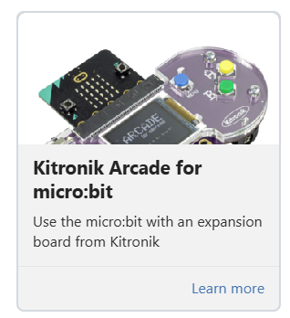
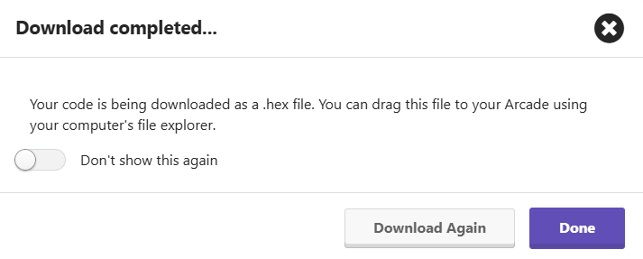
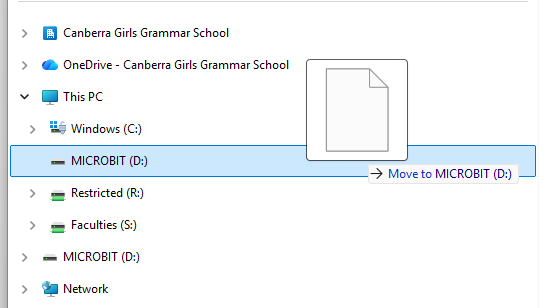
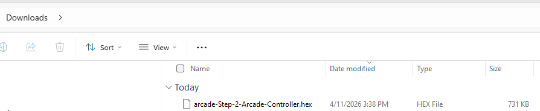

### @title Battle Bot 3: Safety Stop (Controller)

### @description Pick your team, then keep talking to your robot so its safety stop works.

### @preferredEditor blocks

### @explicitHints true

# Battle Bot 3: Safety Stop (Controller)

```package
radio
```

```template
let TEAM_BLUE = 0
let TEAM_RED = 0
let REVERSE = 0
let FORWARD = 0
let STOP = 0
let SPIN_RIGHT = 0
let SPIN_LEFT = 0
let duck: Image = null
let heart: Image = null
let ghost: Image = null
let rabbit: Image = null
let giraffe: Image = null
let snake: Image = null
let arrowUp: Image = null
let arrowDown: Image = null
let arrowLeft: Image = null
let arrowRight: Image = null
let stopSign: Image = null
let channel = ""
// CHANGE THIS: the SAME icon name as your robot, e.g. duck
channel = "duck"
// CHANGE THIS: the SAME group number as your robot
radio.setGroup(101)
SPIN_LEFT = 0
SPIN_RIGHT = 1
STOP = 2
FORWARD = 3
REVERSE = 4
TEAM_RED = 5
TEAM_BLUE = 6
scene.setBackgroundColor(15)
setupPictures()
let bot = sprites.create(duck, SpriteKind.Player)
bot.setPosition(45, 60)
let arrow = sprites.create(stopSign, SpriteKind.Player)
arrow.setPosition(115, 60)
controller.up.onEvent(ControllerButtonEvent.Pressed, function () {
    radio.sendValue(channel, FORWARD)
    arrow.setImage(arrowUp)
})
controller.up.onEvent(ControllerButtonEvent.Released, function () {
    radio.sendValue(channel, STOP)
    arrow.setImage(stopSign)
})
controller.down.onEvent(ControllerButtonEvent.Pressed, function () {
    radio.sendValue(channel, REVERSE)
    arrow.setImage(arrowDown)
})
controller.down.onEvent(ControllerButtonEvent.Released, function () {
    radio.sendValue(channel, STOP)
    arrow.setImage(stopSign)
})
controller.left.onEvent(ControllerButtonEvent.Pressed, function () {
    radio.sendValue(channel, SPIN_LEFT)
    arrow.setImage(arrowLeft)
})
controller.left.onEvent(ControllerButtonEvent.Released, function () {
    radio.sendValue(channel, STOP)
    arrow.setImage(stopSign)
})
controller.right.onEvent(ControllerButtonEvent.Pressed, function () {
    radio.sendValue(channel, SPIN_RIGHT)
    arrow.setImage(arrowRight)
})
controller.right.onEvent(ControllerButtonEvent.Released, function () {
    radio.sendValue(channel, STOP)
    arrow.setImage(stopSign)
})
// Ready-made pictures - no need to change these
function setupPictures () {
    duck = img`
        . . . . . . . . . . . . . . . . . . . . . . . . . . . . . . . .
        . . . . . . . 5 5 5 5 5 5 5 5 5 5 5 5 . . . . . . . . . . . . .
        . . . . . . . 5 5 5 5 5 5 5 5 5 5 5 5 . . . . . . . . . . . . .
        . . . . . . . 5 5 5 5 5 5 5 5 5 5 5 5 . . . . . . . . . . . . .
        . . . . . . . 5 5 5 5 5 5 5 5 5 5 5 5 . . . . . . . . . . . . .
        . . . . . . . 5 5 5 5 5 5 5 5 5 5 5 5 . . . . . . . . . . . . .
        . . . . . . . 5 5 5 5 5 5 5 5 5 5 5 5 . . . . . . . . . . . . .
        . 5 5 5 5 5 5 5 5 5 5 5 5 5 5 5 5 5 5 . . . . . . . . . . . . .
        . 5 5 5 5 5 5 5 5 5 5 5 5 5 5 5 5 5 5 . . . . . . . . . . . . .
        . 5 5 5 5 5 5 5 5 5 5 5 5 5 5 5 5 5 5 . . . . . . . . . . . . .
        . 5 5 5 5 5 5 5 5 5 5 5 5 5 5 5 5 5 5 . . . . . . . . . . . . .
        . 5 5 5 5 5 5 5 5 5 5 5 5 5 5 5 5 5 5 . . . . . . . . . . . . .
        . 5 5 5 5 5 5 5 5 5 5 5 5 5 5 5 5 5 5 . . . . . . . . . . . . .
        . . . . . . . 5 5 5 5 5 5 5 5 5 5 5 5 5 5 5 5 5 5 5 5 5 5 5 5 .
        . . . . . . . 5 5 5 5 5 5 5 5 5 5 5 5 5 5 5 5 5 5 5 5 5 5 5 5 .
        . . . . . . . 5 5 5 5 5 5 5 5 5 5 5 5 5 5 5 5 5 5 5 5 5 5 5 5 .
        . . . . . . . 5 5 5 5 5 5 5 5 5 5 5 5 5 5 5 5 5 5 5 5 5 5 5 5 .
        . . . . . . . 5 5 5 5 5 5 5 5 5 5 5 5 5 5 5 5 5 5 5 5 5 5 5 5 .
        . . . . . . . 5 5 5 5 5 5 5 5 5 5 5 5 5 5 5 5 5 5 5 5 5 5 5 5 .
        . . . . . . . 5 5 5 5 5 5 5 5 5 5 5 5 5 5 5 5 5 5 . . . . . . .
        . . . . . . . 5 5 5 5 5 5 5 5 5 5 5 5 5 5 5 5 5 5 . . . . . . .
        . . . . . . . 5 5 5 5 5 5 5 5 5 5 5 5 5 5 5 5 5 5 . . . . . . .
        . . . . . . . 5 5 5 5 5 5 5 5 5 5 5 5 5 5 5 5 5 5 . . . . . . .
        . . . . . . . 5 5 5 5 5 5 5 5 5 5 5 5 5 5 5 5 5 5 . . . . . . .
        . . . . . . . 5 5 5 5 5 5 5 5 5 5 5 5 5 5 5 5 5 5 . . . . . . .
        . . . . . . . . . . . . . . . . . . . . . . . . . . . . . . . .
        . . . . . . . . . . . . . . . . . . . . . . . . . . . . . . . .
        . . . . . . . . . . . . . . . . . . . . . . . . . . . . . . . .
        . . . . . . . . . . . . . . . . . . . . . . . . . . . . . . . .
        . . . . . . . . . . . . . . . . . . . . . . . . . . . . . . . .
        . . . . . . . . . . . . . . . . . . . . . . . . . . . . . . . .
        . . . . . . . . . . . . . . . . . . . . . . . . . . . . . . . .
        `
    heart = img`
        . . . . . . . . . . . . . . . . . . . . . . . . . . . . . . . .
        . . . . . . . 3 3 3 3 3 3 . . . . . . 3 3 3 3 3 3 . . . . . . .
        . . . . . . . 3 3 3 3 3 3 . . . . . . 3 3 3 3 3 3 . . . . . . .
        . . . . . . . 3 3 3 3 3 3 . . . . . . 3 3 3 3 3 3 . . . . . . .
        . . . . . . . 3 3 3 3 3 3 . . . . . . 3 3 3 3 3 3 . . . . . . .
        . . . . . . . 3 3 3 3 3 3 . . . . . . 3 3 3 3 3 3 . . . . . . .
        . . . . . . . 3 3 3 3 3 3 . . . . . . 3 3 3 3 3 3 . . . . . . .
        . 3 3 3 3 3 3 3 3 3 3 3 3 3 3 3 3 3 3 3 3 3 3 3 3 3 3 3 3 3 3 .
        . 3 3 3 3 3 3 3 3 3 3 3 3 3 3 3 3 3 3 3 3 3 3 3 3 3 3 3 3 3 3 .
        . 3 3 3 3 3 3 3 3 3 3 3 3 3 3 3 3 3 3 3 3 3 3 3 3 3 3 3 3 3 3 .
        . 3 3 3 3 3 3 3 3 3 3 3 3 3 3 3 3 3 3 3 3 3 3 3 3 3 3 3 3 3 3 .
        . 3 3 3 3 3 3 3 3 3 3 3 3 3 3 3 3 3 3 3 3 3 3 3 3 3 3 3 3 3 3 .
        . 3 3 3 3 3 3 3 3 3 3 3 3 3 3 3 3 3 3 3 3 3 3 3 3 3 3 3 3 3 3 .
        . 3 3 3 3 3 3 3 3 3 3 3 3 3 3 3 3 3 3 3 3 3 3 3 3 3 3 3 3 3 3 .
        . 3 3 3 3 3 3 3 3 3 3 3 3 3 3 3 3 3 3 3 3 3 3 3 3 3 3 3 3 3 3 .
        . 3 3 3 3 3 3 3 3 3 3 3 3 3 3 3 3 3 3 3 3 3 3 3 3 3 3 3 3 3 3 .
        . 3 3 3 3 3 3 3 3 3 3 3 3 3 3 3 3 3 3 3 3 3 3 3 3 3 3 3 3 3 3 .
        . 3 3 3 3 3 3 3 3 3 3 3 3 3 3 3 3 3 3 3 3 3 3 3 3 3 3 3 3 3 3 .
        . 3 3 3 3 3 3 3 3 3 3 3 3 3 3 3 3 3 3 3 3 3 3 3 3 3 3 3 3 3 3 .
        . . . . . . . 3 3 3 3 3 3 3 3 3 3 3 3 3 3 3 3 3 3 . . . . . . .
        . . . . . . . 3 3 3 3 3 3 3 3 3 3 3 3 3 3 3 3 3 3 . . . . . . .
        . . . . . . . 3 3 3 3 3 3 3 3 3 3 3 3 3 3 3 3 3 3 . . . . . . .
        . . . . . . . 3 3 3 3 3 3 3 3 3 3 3 3 3 3 3 3 3 3 . . . . . . .
        . . . . . . . 3 3 3 3 3 3 3 3 3 3 3 3 3 3 3 3 3 3 . . . . . . .
        . . . . . . . 3 3 3 3 3 3 3 3 3 3 3 3 3 3 3 3 3 3 . . . . . . .
        . . . . . . . . . . . . . 3 3 3 3 3 3 . . . . . . . . . . . . .
        . . . . . . . . . . . . . 3 3 3 3 3 3 . . . . . . . . . . . . .
        . . . . . . . . . . . . . 3 3 3 3 3 3 . . . . . . . . . . . . .
        . . . . . . . . . . . . . 3 3 3 3 3 3 . . . . . . . . . . . . .
        . . . . . . . . . . . . . 3 3 3 3 3 3 . . . . . . . . . . . . .
        . . . . . . . . . . . . . 3 3 3 3 3 3 . . . . . . . . . . . . .
        . . . . . . . . . . . . . . . . . . . . . . . . . . . . . . . .
        `
    ghost = img`
        . . . . . . . . . . . . . . . . . . . . . . . . . . . . . . . .
        . 1 1 1 1 1 1 1 1 1 1 1 1 1 1 1 1 1 1 1 1 1 1 1 1 1 1 1 1 1 1 .
        . 1 1 1 1 1 1 1 1 1 1 1 1 1 1 1 1 1 1 1 1 1 1 1 1 1 1 1 1 1 1 .
        . 1 1 1 1 1 1 1 1 1 1 1 1 1 1 1 1 1 1 1 1 1 1 1 1 1 1 1 1 1 1 .
        . 1 1 1 1 1 1 1 1 1 1 1 1 1 1 1 1 1 1 1 1 1 1 1 1 1 1 1 1 1 1 .
        . 1 1 1 1 1 1 1 1 1 1 1 1 1 1 1 1 1 1 1 1 1 1 1 1 1 1 1 1 1 1 .
        . 1 1 1 1 1 1 1 1 1 1 1 1 1 1 1 1 1 1 1 1 1 1 1 1 1 1 1 1 1 1 .
        . 1 1 1 1 1 1 . . . . . . 1 1 1 1 1 1 . . . . . . 1 1 1 1 1 1 .
        . 1 1 1 1 1 1 . . . . . . 1 1 1 1 1 1 . . . . . . 1 1 1 1 1 1 .
        . 1 1 1 1 1 1 . . . . . . 1 1 1 1 1 1 . . . . . . 1 1 1 1 1 1 .
        . 1 1 1 1 1 1 . . . . . . 1 1 1 1 1 1 . . . . . . 1 1 1 1 1 1 .
        . 1 1 1 1 1 1 . . . . . . 1 1 1 1 1 1 . . . . . . 1 1 1 1 1 1 .
        . 1 1 1 1 1 1 . . . . . . 1 1 1 1 1 1 . . . . . . 1 1 1 1 1 1 .
        . 1 1 1 1 1 1 1 1 1 1 1 1 1 1 1 1 1 1 1 1 1 1 1 1 1 1 1 1 1 1 .
        . 1 1 1 1 1 1 1 1 1 1 1 1 1 1 1 1 1 1 1 1 1 1 1 1 1 1 1 1 1 1 .
        . 1 1 1 1 1 1 1 1 1 1 1 1 1 1 1 1 1 1 1 1 1 1 1 1 1 1 1 1 1 1 .
        . 1 1 1 1 1 1 1 1 1 1 1 1 1 1 1 1 1 1 1 1 1 1 1 1 1 1 1 1 1 1 .
        . 1 1 1 1 1 1 1 1 1 1 1 1 1 1 1 1 1 1 1 1 1 1 1 1 1 1 1 1 1 1 .
        . 1 1 1 1 1 1 1 1 1 1 1 1 1 1 1 1 1 1 1 1 1 1 1 1 1 1 1 1 1 1 .
        . 1 1 1 1 1 1 1 1 1 1 1 1 1 1 1 1 1 1 1 1 1 1 1 1 1 1 1 1 1 1 .
        . 1 1 1 1 1 1 1 1 1 1 1 1 1 1 1 1 1 1 1 1 1 1 1 1 1 1 1 1 1 1 .
        . 1 1 1 1 1 1 1 1 1 1 1 1 1 1 1 1 1 1 1 1 1 1 1 1 1 1 1 1 1 1 .
        . 1 1 1 1 1 1 1 1 1 1 1 1 1 1 1 1 1 1 1 1 1 1 1 1 1 1 1 1 1 1 .
        . 1 1 1 1 1 1 1 1 1 1 1 1 1 1 1 1 1 1 1 1 1 1 1 1 1 1 1 1 1 1 .
        . 1 1 1 1 1 1 1 1 1 1 1 1 1 1 1 1 1 1 1 1 1 1 1 1 1 1 1 1 1 1 .
        . 1 1 1 1 1 1 . . . . . . 1 1 1 1 1 1 . . . . . . 1 1 1 1 1 1 .
        . 1 1 1 1 1 1 . . . . . . 1 1 1 1 1 1 . . . . . . 1 1 1 1 1 1 .
        . 1 1 1 1 1 1 . . . . . . 1 1 1 1 1 1 . . . . . . 1 1 1 1 1 1 .
        . 1 1 1 1 1 1 . . . . . . 1 1 1 1 1 1 . . . . . . 1 1 1 1 1 1 .
        . 1 1 1 1 1 1 . . . . . . 1 1 1 1 1 1 . . . . . . 1 1 1 1 1 1 .
        . 1 1 1 1 1 1 . . . . . . 1 1 1 1 1 1 . . . . . . 1 1 1 1 1 1 .
        . . . . . . . . . . . . . . . . . . . . . . . . . . . . . . . .
        `
    rabbit = img`
        . . . . . . . . . . . . . . . . . . . . . . . . . . . . . . . .
        . 3 3 3 3 3 3 . . . . . . 3 3 3 3 3 3 . . . . . . . . . . . . .
        . 3 3 3 3 3 3 . . . . . . 3 3 3 3 3 3 . . . . . . . . . . . . .
        . 3 3 3 3 3 3 . . . . . . 3 3 3 3 3 3 . . . . . . . . . . . . .
        . 3 3 3 3 3 3 . . . . . . 3 3 3 3 3 3 . . . . . . . . . . . . .
        . 3 3 3 3 3 3 . . . . . . 3 3 3 3 3 3 . . . . . . . . . . . . .
        . 3 3 3 3 3 3 . . . . . . 3 3 3 3 3 3 . . . . . . . . . . . . .
        . 3 3 3 3 3 3 . . . . . . 3 3 3 3 3 3 . . . . . . . . . . . . .
        . 3 3 3 3 3 3 . . . . . . 3 3 3 3 3 3 . . . . . . . . . . . . .
        . 3 3 3 3 3 3 . . . . . . 3 3 3 3 3 3 . . . . . . . . . . . . .
        . 3 3 3 3 3 3 . . . . . . 3 3 3 3 3 3 . . . . . . . . . . . . .
        . 3 3 3 3 3 3 . . . . . . 3 3 3 3 3 3 . . . . . . . . . . . . .
        . 3 3 3 3 3 3 . . . . . . 3 3 3 3 3 3 . . . . . . . . . . . . .
        . 3 3 3 3 3 3 3 3 3 3 3 3 3 3 3 3 3 3 3 3 3 3 3 3 . . . . . . .
        . 3 3 3 3 3 3 3 3 3 3 3 3 3 3 3 3 3 3 3 3 3 3 3 3 . . . . . . .
        . 3 3 3 3 3 3 3 3 3 3 3 3 3 3 3 3 3 3 3 3 3 3 3 3 . . . . . . .
        . 3 3 3 3 3 3 3 3 3 3 3 3 3 3 3 3 3 3 3 3 3 3 3 3 . . . . . . .
        . 3 3 3 3 3 3 3 3 3 3 3 3 3 3 3 3 3 3 3 3 3 3 3 3 . . . . . . .
        . 3 3 3 3 3 3 3 3 3 3 3 3 3 3 3 3 3 3 3 3 3 3 3 3 . . . . . . .
        . 3 3 3 3 3 3 3 3 3 3 3 3 . . . . . . 3 3 3 3 3 3 . . . . . . .
        . 3 3 3 3 3 3 3 3 3 3 3 3 . . . . . . 3 3 3 3 3 3 . . . . . . .
        . 3 3 3 3 3 3 3 3 3 3 3 3 . . . . . . 3 3 3 3 3 3 . . . . . . .
        . 3 3 3 3 3 3 3 3 3 3 3 3 . . . . . . 3 3 3 3 3 3 . . . . . . .
        . 3 3 3 3 3 3 3 3 3 3 3 3 . . . . . . 3 3 3 3 3 3 . . . . . . .
        . 3 3 3 3 3 3 3 3 3 3 3 3 . . . . . . 3 3 3 3 3 3 . . . . . . .
        . 3 3 3 3 3 3 3 3 3 3 3 3 3 3 3 3 3 3 3 3 3 3 3 3 . . . . . . .
        . 3 3 3 3 3 3 3 3 3 3 3 3 3 3 3 3 3 3 3 3 3 3 3 3 . . . . . . .
        . 3 3 3 3 3 3 3 3 3 3 3 3 3 3 3 3 3 3 3 3 3 3 3 3 . . . . . . .
        . 3 3 3 3 3 3 3 3 3 3 3 3 3 3 3 3 3 3 3 3 3 3 3 3 . . . . . . .
        . 3 3 3 3 3 3 3 3 3 3 3 3 3 3 3 3 3 3 3 3 3 3 3 3 . . . . . . .
        . 3 3 3 3 3 3 3 3 3 3 3 3 3 3 3 3 3 3 3 3 3 3 3 3 . . . . . . .
        . . . . . . . . . . . . . . . . . . . . . . . . . . . . . . . .
        `
    giraffe = img`
        . . . . . . . . . . . . . . . . . . . . . . . . . . . . . . . .
        . 4 4 4 4 4 4 4 4 4 4 4 4 . . . . . . . . . . . . . . . . . . .
        . 4 4 4 4 4 4 4 4 4 4 4 4 . . . . . . . . . . . . . . . . . . .
        . 4 4 4 4 4 4 4 4 4 4 4 4 . . . . . . . . . . . . . . . . . . .
        . 4 4 4 4 4 4 4 4 4 4 4 4 . . . . . . . . . . . . . . . . . . .
        . 4 4 4 4 4 4 4 4 4 4 4 4 . . . . . . . . . . . . . . . . . . .
        . 4 4 4 4 4 4 4 4 4 4 4 4 . . . . . . . . . . . . . . . . . . .
        . . . . . . . 4 4 4 4 4 4 . . . . . . . . . . . . . . . . . . .
        . . . . . . . 4 4 4 4 4 4 . . . . . . . . . . . . . . . . . . .
        . . . . . . . 4 4 4 4 4 4 . . . . . . . . . . . . . . . . . . .
        . . . . . . . 4 4 4 4 4 4 . . . . . . . . . . . . . . . . . . .
        . . . . . . . 4 4 4 4 4 4 . . . . . . . . . . . . . . . . . . .
        . . . . . . . 4 4 4 4 4 4 . . . . . . . . . . . . . . . . . . .
        . . . . . . . 4 4 4 4 4 4 . . . . . . . . . . . . . . . . . . .
        . . . . . . . 4 4 4 4 4 4 . . . . . . . . . . . . . . . . . . .
        . . . . . . . 4 4 4 4 4 4 . . . . . . . . . . . . . . . . . . .
        . . . . . . . 4 4 4 4 4 4 . . . . . . . . . . . . . . . . . . .
        . . . . . . . 4 4 4 4 4 4 . . . . . . . . . . . . . . . . . . .
        . . . . . . . 4 4 4 4 4 4 . . . . . . . . . . . . . . . . . . .
        . . . . . . . 4 4 4 4 4 4 4 4 4 4 4 4 4 4 4 4 4 4 . . . . . . .
        . . . . . . . 4 4 4 4 4 4 4 4 4 4 4 4 4 4 4 4 4 4 . . . . . . .
        . . . . . . . 4 4 4 4 4 4 4 4 4 4 4 4 4 4 4 4 4 4 . . . . . . .
        . . . . . . . 4 4 4 4 4 4 4 4 4 4 4 4 4 4 4 4 4 4 . . . . . . .
        . . . . . . . 4 4 4 4 4 4 4 4 4 4 4 4 4 4 4 4 4 4 . . . . . . .
        . . . . . . . 4 4 4 4 4 4 4 4 4 4 4 4 4 4 4 4 4 4 . . . . . . .
        . . . . . . . 4 4 4 4 4 4 . . . . . . 4 4 4 4 4 4 . . . . . . .
        . . . . . . . 4 4 4 4 4 4 . . . . . . 4 4 4 4 4 4 . . . . . . .
        . . . . . . . 4 4 4 4 4 4 . . . . . . 4 4 4 4 4 4 . . . . . . .
        . . . . . . . 4 4 4 4 4 4 . . . . . . 4 4 4 4 4 4 . . . . . . .
        . . . . . . . 4 4 4 4 4 4 . . . . . . 4 4 4 4 4 4 . . . . . . .
        . . . . . . . 4 4 4 4 4 4 . . . . . . 4 4 4 4 4 4 . . . . . . .
        . . . . . . . . . . . . . . . . . . . . . . . . . . . . . . . .
        `
    snake = img`
        . . . . . . . . . . . . . . . . . . . . . . . . . . . . . . . .
        . 7 7 7 7 7 7 7 7 7 7 7 7 . . . . . . . . . . . . . . . . . . .
        . 7 7 7 7 7 7 7 7 7 7 7 7 . . . . . . . . . . . . . . . . . . .
        . 7 7 7 7 7 7 7 7 7 7 7 7 . . . . . . . . . . . . . . . . . . .
        . 7 7 7 7 7 7 7 7 7 7 7 7 . . . . . . . . . . . . . . . . . . .
        . 7 7 7 7 7 7 7 7 7 7 7 7 . . . . . . . . . . . . . . . . . . .
        . 7 7 7 7 7 7 7 7 7 7 7 7 . . . . . . . . . . . . . . . . . . .
        . 7 7 7 7 7 7 7 7 7 7 7 7 . . . . . . 7 7 7 7 7 7 7 7 7 7 7 7 .
        . 7 7 7 7 7 7 7 7 7 7 7 7 . . . . . . 7 7 7 7 7 7 7 7 7 7 7 7 .
        . 7 7 7 7 7 7 7 7 7 7 7 7 . . . . . . 7 7 7 7 7 7 7 7 7 7 7 7 .
        . 7 7 7 7 7 7 7 7 7 7 7 7 . . . . . . 7 7 7 7 7 7 7 7 7 7 7 7 .
        . 7 7 7 7 7 7 7 7 7 7 7 7 . . . . . . 7 7 7 7 7 7 7 7 7 7 7 7 .
        . 7 7 7 7 7 7 7 7 7 7 7 7 . . . . . . 7 7 7 7 7 7 7 7 7 7 7 7 .
        . . . . . . . 7 7 7 7 7 7 . . . . . . 7 7 7 7 7 7 . . . . . . .
        . . . . . . . 7 7 7 7 7 7 . . . . . . 7 7 7 7 7 7 . . . . . . .
        . . . . . . . 7 7 7 7 7 7 . . . . . . 7 7 7 7 7 7 . . . . . . .
        . . . . . . . 7 7 7 7 7 7 . . . . . . 7 7 7 7 7 7 . . . . . . .
        . . . . . . . 7 7 7 7 7 7 . . . . . . 7 7 7 7 7 7 . . . . . . .
        . . . . . . . 7 7 7 7 7 7 . . . . . . 7 7 7 7 7 7 . . . . . . .
        . . . . . . . 7 7 7 7 7 7 7 7 7 7 7 7 7 7 7 7 7 7 . . . . . . .
        . . . . . . . 7 7 7 7 7 7 7 7 7 7 7 7 7 7 7 7 7 7 . . . . . . .
        . . . . . . . 7 7 7 7 7 7 7 7 7 7 7 7 7 7 7 7 7 7 . . . . . . .
        . . . . . . . 7 7 7 7 7 7 7 7 7 7 7 7 7 7 7 7 7 7 . . . . . . .
        . . . . . . . 7 7 7 7 7 7 7 7 7 7 7 7 7 7 7 7 7 7 . . . . . . .
        . . . . . . . 7 7 7 7 7 7 7 7 7 7 7 7 7 7 7 7 7 7 . . . . . . .
        . . . . . . . . . . . . . . . . . . . . . . . . . . . . . . . .
        . . . . . . . . . . . . . . . . . . . . . . . . . . . . . . . .
        . . . . . . . . . . . . . . . . . . . . . . . . . . . . . . . .
        . . . . . . . . . . . . . . . . . . . . . . . . . . . . . . . .
        . . . . . . . . . . . . . . . . . . . . . . . . . . . . . . . .
        . . . . . . . . . . . . . . . . . . . . . . . . . . . . . . . .
        . . . . . . . . . . . . . . . . . . . . . . . . . . . . . . . .
        `
    arrowUp = img`
        . . . . . . . . . . . . . . . . . . . . . . . . . . . . . . . .
        . . . . . . . . . . . . . 1 1 1 1 1 1 . . . . . . . . . . . . .
        . . . . . . . . . . . . . 1 1 1 1 1 1 . . . . . . . . . . . . .
        . . . . . . . . . . . . . 1 1 1 1 1 1 . . . . . . . . . . . . .
        . . . . . . . . . . . . . 1 1 1 1 1 1 . . . . . . . . . . . . .
        . . . . . . . . . . . . . 1 1 1 1 1 1 . . . . . . . . . . . . .
        . . . . . . . . . . . . . 1 1 1 1 1 1 . . . . . . . . . . . . .
        . . . . . . . 1 1 1 1 1 1 1 1 1 1 1 1 1 1 1 1 1 1 . . . . . . .
        . . . . . . . 1 1 1 1 1 1 1 1 1 1 1 1 1 1 1 1 1 1 . . . . . . .
        . . . . . . . 1 1 1 1 1 1 1 1 1 1 1 1 1 1 1 1 1 1 . . . . . . .
        . . . . . . . 1 1 1 1 1 1 1 1 1 1 1 1 1 1 1 1 1 1 . . . . . . .
        . . . . . . . 1 1 1 1 1 1 1 1 1 1 1 1 1 1 1 1 1 1 . . . . . . .
        . . . . . . . 1 1 1 1 1 1 1 1 1 1 1 1 1 1 1 1 1 1 . . . . . . .
        . 1 1 1 1 1 1 . . . . . . 1 1 1 1 1 1 . . . . . . 1 1 1 1 1 1 .
        . 1 1 1 1 1 1 . . . . . . 1 1 1 1 1 1 . . . . . . 1 1 1 1 1 1 .
        . 1 1 1 1 1 1 . . . . . . 1 1 1 1 1 1 . . . . . . 1 1 1 1 1 1 .
        . 1 1 1 1 1 1 . . . . . . 1 1 1 1 1 1 . . . . . . 1 1 1 1 1 1 .
        . 1 1 1 1 1 1 . . . . . . 1 1 1 1 1 1 . . . . . . 1 1 1 1 1 1 .
        . 1 1 1 1 1 1 . . . . . . 1 1 1 1 1 1 . . . . . . 1 1 1 1 1 1 .
        . . . . . . . . . . . . . 1 1 1 1 1 1 . . . . . . . . . . . . .
        . . . . . . . . . . . . . 1 1 1 1 1 1 . . . . . . . . . . . . .
        . . . . . . . . . . . . . 1 1 1 1 1 1 . . . . . . . . . . . . .
        . . . . . . . . . . . . . 1 1 1 1 1 1 . . . . . . . . . . . . .
        . . . . . . . . . . . . . 1 1 1 1 1 1 . . . . . . . . . . . . .
        . . . . . . . . . . . . . 1 1 1 1 1 1 . . . . . . . . . . . . .
        . . . . . . . . . . . . . 1 1 1 1 1 1 . . . . . . . . . . . . .
        . . . . . . . . . . . . . 1 1 1 1 1 1 . . . . . . . . . . . . .
        . . . . . . . . . . . . . 1 1 1 1 1 1 . . . . . . . . . . . . .
        . . . . . . . . . . . . . 1 1 1 1 1 1 . . . . . . . . . . . . .
        . . . . . . . . . . . . . 1 1 1 1 1 1 . . . . . . . . . . . . .
        . . . . . . . . . . . . . 1 1 1 1 1 1 . . . . . . . . . . . . .
        . . . . . . . . . . . . . . . . . . . . . . . . . . . . . . . .
        `
    arrowDown = img`
        . . . . . . . . . . . . . . . . . . . . . . . . . . . . . . . .
        . . . . . . . . . . . . . 1 1 1 1 1 1 . . . . . . . . . . . . .
        . . . . . . . . . . . . . 1 1 1 1 1 1 . . . . . . . . . . . . .
        . . . . . . . . . . . . . 1 1 1 1 1 1 . . . . . . . . . . . . .
        . . . . . . . . . . . . . 1 1 1 1 1 1 . . . . . . . . . . . . .
        . . . . . . . . . . . . . 1 1 1 1 1 1 . . . . . . . . . . . . .
        . . . . . . . . . . . . . 1 1 1 1 1 1 . . . . . . . . . . . . .
        . . . . . . . . . . . . . 1 1 1 1 1 1 . . . . . . . . . . . . .
        . . . . . . . . . . . . . 1 1 1 1 1 1 . . . . . . . . . . . . .
        . . . . . . . . . . . . . 1 1 1 1 1 1 . . . . . . . . . . . . .
        . . . . . . . . . . . . . 1 1 1 1 1 1 . . . . . . . . . . . . .
        . . . . . . . . . . . . . 1 1 1 1 1 1 . . . . . . . . . . . . .
        . . . . . . . . . . . . . 1 1 1 1 1 1 . . . . . . . . . . . . .
        . 1 1 1 1 1 1 . . . . . . 1 1 1 1 1 1 . . . . . . 1 1 1 1 1 1 .
        . 1 1 1 1 1 1 . . . . . . 1 1 1 1 1 1 . . . . . . 1 1 1 1 1 1 .
        . 1 1 1 1 1 1 . . . . . . 1 1 1 1 1 1 . . . . . . 1 1 1 1 1 1 .
        . 1 1 1 1 1 1 . . . . . . 1 1 1 1 1 1 . . . . . . 1 1 1 1 1 1 .
        . 1 1 1 1 1 1 . . . . . . 1 1 1 1 1 1 . . . . . . 1 1 1 1 1 1 .
        . 1 1 1 1 1 1 . . . . . . 1 1 1 1 1 1 . . . . . . 1 1 1 1 1 1 .
        . . . . . . . 1 1 1 1 1 1 1 1 1 1 1 1 1 1 1 1 1 1 . . . . . . .
        . . . . . . . 1 1 1 1 1 1 1 1 1 1 1 1 1 1 1 1 1 1 . . . . . . .
        . . . . . . . 1 1 1 1 1 1 1 1 1 1 1 1 1 1 1 1 1 1 . . . . . . .
        . . . . . . . 1 1 1 1 1 1 1 1 1 1 1 1 1 1 1 1 1 1 . . . . . . .
        . . . . . . . 1 1 1 1 1 1 1 1 1 1 1 1 1 1 1 1 1 1 . . . . . . .
        . . . . . . . 1 1 1 1 1 1 1 1 1 1 1 1 1 1 1 1 1 1 . . . . . . .
        . . . . . . . . . . . . . 1 1 1 1 1 1 . . . . . . . . . . . . .
        . . . . . . . . . . . . . 1 1 1 1 1 1 . . . . . . . . . . . . .
        . . . . . . . . . . . . . 1 1 1 1 1 1 . . . . . . . . . . . . .
        . . . . . . . . . . . . . 1 1 1 1 1 1 . . . . . . . . . . . . .
        . . . . . . . . . . . . . 1 1 1 1 1 1 . . . . . . . . . . . . .
        . . . . . . . . . . . . . 1 1 1 1 1 1 . . . . . . . . . . . . .
        . . . . . . . . . . . . . . . . . . . . . . . . . . . . . . . .
        `
    arrowLeft = img`
        . . . . . . . . . . . . . . . . . . . . . . . . . . . . . . . .
        . . . . . . . . . . . . . 1 1 1 1 1 1 . . . . . . . . . . . . .
        . . . . . . . . . . . . . 1 1 1 1 1 1 . . . . . . . . . . . . .
        . . . . . . . . . . . . . 1 1 1 1 1 1 . . . . . . . . . . . . .
        . . . . . . . . . . . . . 1 1 1 1 1 1 . . . . . . . . . . . . .
        . . . . . . . . . . . . . 1 1 1 1 1 1 . . . . . . . . . . . . .
        . . . . . . . . . . . . . 1 1 1 1 1 1 . . . . . . . . . . . . .
        . . . . . . . 1 1 1 1 1 1 . . . . . . . . . . . . . . . . . . .
        . . . . . . . 1 1 1 1 1 1 . . . . . . . . . . . . . . . . . . .
        . . . . . . . 1 1 1 1 1 1 . . . . . . . . . . . . . . . . . . .
        . . . . . . . 1 1 1 1 1 1 . . . . . . . . . . . . . . . . . . .
        . . . . . . . 1 1 1 1 1 1 . . . . . . . . . . . . . . . . . . .
        . . . . . . . 1 1 1 1 1 1 . . . . . . . . . . . . . . . . . . .
        . 1 1 1 1 1 1 1 1 1 1 1 1 1 1 1 1 1 1 1 1 1 1 1 1 1 1 1 1 1 1 .
        . 1 1 1 1 1 1 1 1 1 1 1 1 1 1 1 1 1 1 1 1 1 1 1 1 1 1 1 1 1 1 .
        . 1 1 1 1 1 1 1 1 1 1 1 1 1 1 1 1 1 1 1 1 1 1 1 1 1 1 1 1 1 1 .
        . 1 1 1 1 1 1 1 1 1 1 1 1 1 1 1 1 1 1 1 1 1 1 1 1 1 1 1 1 1 1 .
        . 1 1 1 1 1 1 1 1 1 1 1 1 1 1 1 1 1 1 1 1 1 1 1 1 1 1 1 1 1 1 .
        . 1 1 1 1 1 1 1 1 1 1 1 1 1 1 1 1 1 1 1 1 1 1 1 1 1 1 1 1 1 1 .
        . . . . . . . 1 1 1 1 1 1 . . . . . . . . . . . . . . . . . . .
        . . . . . . . 1 1 1 1 1 1 . . . . . . . . . . . . . . . . . . .
        . . . . . . . 1 1 1 1 1 1 . . . . . . . . . . . . . . . . . . .
        . . . . . . . 1 1 1 1 1 1 . . . . . . . . . . . . . . . . . . .
        . . . . . . . 1 1 1 1 1 1 . . . . . . . . . . . . . . . . . . .
        . . . . . . . 1 1 1 1 1 1 . . . . . . . . . . . . . . . . . . .
        . . . . . . . . . . . . . 1 1 1 1 1 1 . . . . . . . . . . . . .
        . . . . . . . . . . . . . 1 1 1 1 1 1 . . . . . . . . . . . . .
        . . . . . . . . . . . . . 1 1 1 1 1 1 . . . . . . . . . . . . .
        . . . . . . . . . . . . . 1 1 1 1 1 1 . . . . . . . . . . . . .
        . . . . . . . . . . . . . 1 1 1 1 1 1 . . . . . . . . . . . . .
        . . . . . . . . . . . . . 1 1 1 1 1 1 . . . . . . . . . . . . .
        . . . . . . . . . . . . . . . . . . . . . . . . . . . . . . . .
        `
    arrowRight = img`
        . . . . . . . . . . . . . . . . . . . . . . . . . . . . . . . .
        . . . . . . . . . . . . . 1 1 1 1 1 1 . . . . . . . . . . . . .
        . . . . . . . . . . . . . 1 1 1 1 1 1 . . . . . . . . . . . . .
        . . . . . . . . . . . . . 1 1 1 1 1 1 . . . . . . . . . . . . .
        . . . . . . . . . . . . . 1 1 1 1 1 1 . . . . . . . . . . . . .
        . . . . . . . . . . . . . 1 1 1 1 1 1 . . . . . . . . . . . . .
        . . . . . . . . . . . . . 1 1 1 1 1 1 . . . . . . . . . . . . .
        . . . . . . . . . . . . . . . . . . . 1 1 1 1 1 1 . . . . . . .
        . . . . . . . . . . . . . . . . . . . 1 1 1 1 1 1 . . . . . . .
        . . . . . . . . . . . . . . . . . . . 1 1 1 1 1 1 . . . . . . .
        . . . . . . . . . . . . . . . . . . . 1 1 1 1 1 1 . . . . . . .
        . . . . . . . . . . . . . . . . . . . 1 1 1 1 1 1 . . . . . . .
        . . . . . . . . . . . . . . . . . . . 1 1 1 1 1 1 . . . . . . .
        . 1 1 1 1 1 1 1 1 1 1 1 1 1 1 1 1 1 1 1 1 1 1 1 1 1 1 1 1 1 1 .
        . 1 1 1 1 1 1 1 1 1 1 1 1 1 1 1 1 1 1 1 1 1 1 1 1 1 1 1 1 1 1 .
        . 1 1 1 1 1 1 1 1 1 1 1 1 1 1 1 1 1 1 1 1 1 1 1 1 1 1 1 1 1 1 .
        . 1 1 1 1 1 1 1 1 1 1 1 1 1 1 1 1 1 1 1 1 1 1 1 1 1 1 1 1 1 1 .
        . 1 1 1 1 1 1 1 1 1 1 1 1 1 1 1 1 1 1 1 1 1 1 1 1 1 1 1 1 1 1 .
        . 1 1 1 1 1 1 1 1 1 1 1 1 1 1 1 1 1 1 1 1 1 1 1 1 1 1 1 1 1 1 .
        . . . . . . . . . . . . . . . . . . . 1 1 1 1 1 1 . . . . . . .
        . . . . . . . . . . . . . . . . . . . 1 1 1 1 1 1 . . . . . . .
        . . . . . . . . . . . . . . . . . . . 1 1 1 1 1 1 . . . . . . .
        . . . . . . . . . . . . . . . . . . . 1 1 1 1 1 1 . . . . . . .
        . . . . . . . . . . . . . . . . . . . 1 1 1 1 1 1 . . . . . . .
        . . . . . . . . . . . . . . . . . . . 1 1 1 1 1 1 . . . . . . .
        . . . . . . . . . . . . . 1 1 1 1 1 1 . . . . . . . . . . . . .
        . . . . . . . . . . . . . 1 1 1 1 1 1 . . . . . . . . . . . . .
        . . . . . . . . . . . . . 1 1 1 1 1 1 . . . . . . . . . . . . .
        . . . . . . . . . . . . . 1 1 1 1 1 1 . . . . . . . . . . . . .
        . . . . . . . . . . . . . 1 1 1 1 1 1 . . . . . . . . . . . . .
        . . . . . . . . . . . . . 1 1 1 1 1 1 . . . . . . . . . . . . .
        . . . . . . . . . . . . . . . . . . . . . . . . . . . . . . . .
        `
    stopSign = img`
    . . . . . . . . . . . . . . . . . . . . . . . . . . . . . . . .
    . 1 1 1 1 1 1 . . . . . . . . . . . . . . . . . . 1 1 1 1 1 1 .
    . 1 1 1 1 1 1 . . . . . . . . . . . . . . . . . . 1 1 1 1 1 1 .
    . 1 1 1 1 1 1 . . . . . . . . . . . . . . . . . . 1 1 1 1 1 1 .
    . 1 1 1 1 1 1 . . . . . . . . . . . . . . . . . . 1 1 1 1 1 1 .
    . 1 1 1 1 1 1 . . . . . . . . . . . . . . . . . . 1 1 1 1 1 1 .
    . 1 1 1 1 1 1 . . . . . . . . . . . . . . . . . . 1 1 1 1 1 1 .
    . . . . . . . 1 1 1 1 1 1 . . . . . . 1 1 1 1 1 1 . . . . . . .
    . . . . . . . 1 1 1 1 1 1 . . . . . . 1 1 1 1 1 1 . . . . . . .
    . . . . . . . 1 1 1 1 1 1 . . . . . . 1 1 1 1 1 1 . . . . . . .
    . . . . . . . 1 1 1 1 1 1 . . . . . . 1 1 1 1 1 1 . . . . . . .
    . . . . . . . 1 1 1 1 1 1 . . . . . . 1 1 1 1 1 1 . . . . . . .
    . . . . . . . 1 1 1 1 1 1 . . . . . . 1 1 1 1 1 1 . . . . . . .
    . . . . . . . . . . . . . 1 1 1 1 1 1 . . . . . . . . . . . . .
    . . . . . . . . . . . . . 1 1 1 1 1 1 . . . . . . . . . . . . .
    . . . . . . . . . . . . . 1 1 1 1 1 1 . . . . . . . . . . . . .
    . . . . . . . . . . . . . 1 1 1 1 1 1 . . . . . . . . . . . . .
    . . . . . . . . . . . . . 1 1 1 1 1 1 . . . . . . . . . . . . .
    . . . . . . . . . . . . . 1 1 1 1 1 1 . . . . . . . . . . . . .
    . . . . . . . 1 1 1 1 1 1 . . . . . . 1 1 1 1 1 1 . . . . . . .
    . . . . . . . 1 1 1 1 1 1 . . . . . . 1 1 1 1 1 1 . . . . . . .
    . . . . . . . 1 1 1 1 1 1 . . . . . . 1 1 1 1 1 1 . . . . . . .
    . . . . . . . 1 1 1 1 1 1 . . . . . . 1 1 1 1 1 1 . . . . . . .
    . . . . . . . 1 1 1 1 1 1 . . . . . . 1 1 1 1 1 1 . . . . . . .
    . . . . . . . 1 1 1 1 1 1 . . . . . . 1 1 1 1 1 1 . . . . . . .
    . 1 1 1 1 1 1 . . . . . . . . . . . . . . . . . . 1 1 1 1 1 1 .
    . 1 1 1 1 1 1 . . . . . . . . . . . . . . . . . . 1 1 1 1 1 1 .
    . 1 1 1 1 1 1 . . . . . . . . . . . . . . . . . . 1 1 1 1 1 1 .
    . 1 1 1 1 1 1 . . . . . . . . . . . . . . . . . . 1 1 1 1 1 1 .
    . 1 1 1 1 1 1 . . . . . . . . . . . . . . . . . . 1 1 1 1 1 1 .
    . 1 1 1 1 1 1 . . . . . . . . . . . . . . . . . . 1 1 1 1 1 1 .
    . . . . . . . . . . . . . . . . . . . . . . . . . . . . . . . .
    `
}
```

## Introduction @showdialog
Your robot now has a **safety stop**: if it doesn't hear from you for half a second, it stops.

But your controller only sends a message when you **press** or **let go**. While you hold a button, it sends nothing, so the robot stops.

Today your controller will **keep talking**. It will also let you **pick your team**.

## Step 1: Match Your Robot
Change ``||radio:radio set group||`` and ``||variables:set channel to||`` to match **your** robot. In ``||variables:set bot to sprite||``, pick your icon.

#### ~ tutorialhint
Every tutorial starts fresh with the **duck** and group **101**. Use the same ones as your robot. Here's a **heart** robot, for example:

```blocks
let heart: Image = null
let channel = ""
channel = "heart"
radio.setGroup(101)
let bot = sprites.create(heart, SpriteKind.Player)
```

## Pick Your Team @showdialog
When your controller starts, it will ask: **Red team?**
- Press **A** for **red**
- Press **B** for **blue**

The screen turns your team colour, and so do your robot's lights.

## Step 2: A Team Variable
In ``||variables:Variables||``, make a variable called **team**.

## Step 3: Ask the Question
At the **end** of ``||loops:on start||``, add an ``||logic:if then else||``. From ``||game:Game||``, drag ``||game:ask||`` into it.

Type **Red team?** in the ask block.

#### ~ tutorialhint
Click the **+** on the ask block to add a second line. Type **A = red  B = blue** so players know which button to press.

```blocks
if (game.ask("Red team?", "A = red  B = blue")) {
} else {
}
```

## Step 4: Red or Blue
- In the top part: ``||variables:set team to||`` ``||variables:TEAM_RED||`` and ``||scene:set background color||`` to red
- In the **else** part: ``||variables:set team to||`` ``||variables:TEAM_BLUE||`` and the background to blue

#### ~ tutorialhint
``||variables:TEAM_RED||`` and ``||variables:TEAM_BLUE||`` are new names, already set up for you. They match the robot's.

```blocks
if (game.ask("Red team?", "A = red  B = blue")) {
    team = TEAM_RED
    scene.setBackgroundColor(2)
} else {
    team = TEAM_BLUE
    scene.setBackgroundColor(8)
}
```

## Step 5: Tell the Robot
Under the ``||logic:if||``, add ``||loops:repeat 3 times||``. Inside it: ``||radio:radio send value||`` ``||variables:channel||`` = ``||variables:team||``, then ``||loops:pause 100 ms||``.

#### ~ tutorialhint
Why send it 3 times? In case one message gets lost!

```blocks
if (game.ask("Red team?", "A = red  B = blue")) {
    team = TEAM_RED
    scene.setBackgroundColor(2)
} else {
    team = TEAM_BLUE
    scene.setBackgroundColor(8)
}
for (let index = 0; index < 3; index++) {
    radio.sendValue(channel, team)
    pause(100)
}
```

## Keep Talking @showdialog
Now the big change.

**On pressed** and **on released** run **once**, when a button changes. While you hold a button, they send nothing.

Instead, you'll use **one** block that asks *"which button is held **right now**?"* **10 times every second**, and sends the answer.

Nothing held? It sends ``||variables:STOP||``.

## Step 6: Clear the Old Buttons
Delete all 8 ``||controller:on button pressed||`` and ``||controller:on button released||`` blocks.

## Step 7: Every 100 ms
Make a variable called **command**. From ``||game:Game||``, drag out ``||game:on game update every 500 ms||`` and change **500** to **100**.

#### ~ tutorialhint
100 ms is a tenth of a second, so everything inside runs **10 times every second**.

```blocks
game.onUpdateInterval(100, function () {
})
```

## Step 8: Start With Stop
Inside it, add ``||variables:set command to||`` ``||variables:STOP||`` and ``||sprites:set arrow image to||`` ``||variables:stopSign||``.

#### ~ tutorialhint
Each check starts by assuming **stop**. If a button is held, you'll change it in a moment.

```blocks
let arrow: Sprite = null
game.onUpdateInterval(100, function () {
    command = STOP
    arrow.setImage(stopSign)
})
```

## Step 9: Send It
At the bottom, add ``||radio:radio send value||`` ``||variables:channel||`` = ``||variables:command||``.

#### ~ tutorialhint
Whatever ``||variables:command||`` ends up as gets sent to the robot, 10 times every second.

```blocks
let arrow: Sprite = null
game.onUpdateInterval(100, function () {
    command = STOP
    arrow.setImage(stopSign)
    radio.sendValue(channel, command)
})
```

## Step 10: Is Up Held?
Between the arrow and the send, add ``||logic:if||`` ``||controller:is up button pressed||``.

#### ~ tutorialhint
The question has changed. Before, it was *"did a button just change?"* Now it's *"which button is being held right now?"* ``||controller:is up button pressed||`` is in ``||controller:Controller||``.

```blocks
let arrow: Sprite = null
game.onUpdateInterval(100, function () {
    command = STOP
    arrow.setImage(stopSign)
    if (controller.up.isPressed()) {
    }
    radio.sendValue(channel, command)
})
```

## Step 11: Then Go Forward
Inside the ``||logic:if||``, add ``||variables:set command to||`` ``||variables:FORWARD||`` and ``||sprites:set arrow image to||`` ``||variables:arrowUp||``.

#### ~ tutorialhint
**Duplicate** the two blocks at the top of the loop, drag the copies into the ``||logic:if||``, and change them.

```blocks
let arrow: Sprite = null
game.onUpdateInterval(100, function () {
    command = STOP
    arrow.setImage(stopSign)
    if (controller.up.isPressed()) {
        command = FORWARD
        arrow.setImage(arrowUp)
    }
    radio.sendValue(channel, command)
})
```

## Step 12: The Other Directions
Click **+** on that ``||logic:if||`` three times, for **down**, **left** and **right**.

#### ~ tutorialhint
- down → ``||variables:REVERSE||`` and ``||variables:arrowDown||``
- left → ``||variables:SPIN_LEFT||`` and ``||variables:arrowLeft||``
- right → ``||variables:SPIN_RIGHT||`` and ``||variables:arrowRight||``

**Duplicate** the two blocks inside the up part to fill each new part. New **else if** parts appear above the **else**. You can delete the empty **else**.

```blocks
let arrow: Sprite = null
game.onUpdateInterval(100, function () {
    command = STOP
    arrow.setImage(stopSign)
    if (controller.up.isPressed()) {
        command = FORWARD
        arrow.setImage(arrowUp)
    } else if (controller.down.isPressed()) {
        command = REVERSE
        arrow.setImage(arrowDown)
    } else if (controller.left.isPressed()) {
        command = SPIN_LEFT
        arrow.setImage(arrowLeft)
    } else if (controller.right.isPressed()) {
        command = SPIN_RIGHT
        arrow.setImage(arrowRight)
    }
    radio.sendValue(channel, command)
})
```

## Step 13: Test in the Simulator
Press **Z** (that's **A**) to pick red. Then hold the **arrow keys**. Does the arrow change, and show the stop sign when you let go?

## Step 14: Download the File
1. Click **•••** next to **Download** → **Choose Hardware** → **Kitronik Arcade for micro:bit**.
2. Click **•••** again → **Download as File**.


#### ~ tutorialhint
Pick this one in **Choose Hardware**:



When this box pops up, click **Done**. Your file is saved.



## Step 15: Copy It to Your Controller
1. Plug your controller's micro:bit into the computer with a USB cable.
2. Open **File Explorer** and find your file. Its name starts with **arcade-** and ends in **.hex**.
3. Drag it onto **MICROBIT**.



#### ~ tutorialhint
Can't find the file? It's in your **Downloads** folder:



Or click the **download** button at the top of Chrome, then the **folder** icon:


When the light on the micro:bit stops flashing, it's done.

## Step 16: Test the Safety Stop
Switch on the robot (running **Battle Bot 3: Safety Stop (Robot)**), then the controller.

#### ~ tutorialhint
1. Pick your team. Do the robot's lights change?
2. Hold **up**. The robot keeps driving while you hold.
3. Hold **up**, then switch the controller **off**. The robot should stop within half a second. That's the safety stop!

## Complete! @showdialog
Your controller and robot now keep in touch all the time. If the messages stop, the robot stops. No more runaway robots!

Next: **curves**, **turbo** and **attack**. Start with the robot:

https://makecode.microbit.org/#tutorial:github:cggs-matthew-pham/cggs-stem-club-microbit/battlebot-4-robot
