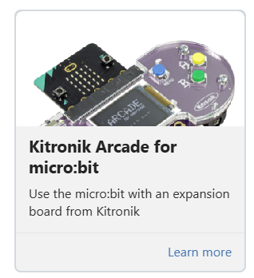
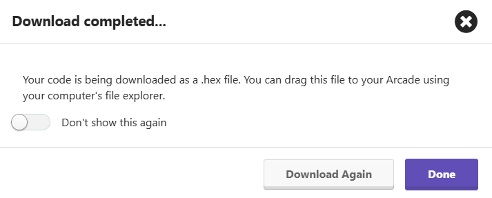
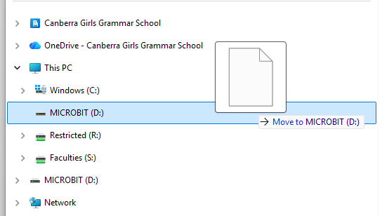

### @title Battle Bot 4: Battle Upgrades (Controller)

### @description Add curving, turbo and attack buttons to your Arcade controller.

### @preferredEditor blocks

### @explicitHints true

# Battle Bot 4: Battle Upgrades (Controller)

```package
radio
```

```template
let ATTACK = 0
let CURVE_RIGHT = 0
let CURVE_LEFT = 0
let TEAM_BLUE = 0
let TEAM_RED = 0
let REVERSE = 0
let FORWARD = 0
let STOP = 0
let SPIN_RIGHT = 0
let SPIN_LEFT = 0
let duck: Image = null
let heart: Image = null
let ghost: Image = null
let rabbit: Image = null
let giraffe: Image = null
let snake: Image = null
let arrowUp: Image = null
let arrowDown: Image = null
let arrowLeft: Image = null
let arrowRight: Image = null
let stopSign: Image = null
let curveRight: Image = null
let curveLeft: Image = null
let team = 0
let command = 0
let channel = ""
// CHANGE THIS: the SAME icon name as your robot, e.g. duck
channel = "duck"
// CHANGE THIS: the SAME group number as your robot
radio.setGroup(101)
SPIN_LEFT = 0
SPIN_RIGHT = 1
STOP = 2
FORWARD = 3
REVERSE = 4
TEAM_RED = 5
TEAM_BLUE = 6
CURVE_LEFT = 7
CURVE_RIGHT = 8
ATTACK = 9
scene.setBackgroundColor(15)
setupPictures()
let bot = sprites.create(duck, SpriteKind.Player)
bot.setPosition(45, 60)
let arrow = sprites.create(stopSign, SpriteKind.Player)
arrow.setPosition(115, 60)
if (game.ask("Red team?", "A = red  B = blue")) {
    team = TEAM_RED
    scene.setBackgroundColor(2)
} else {
    team = TEAM_BLUE
    scene.setBackgroundColor(8)
}
for (let index = 0; index < 3; index++) {
    radio.sendValue(channel, team)
    pause(100)
}
game.onUpdateInterval(100, function () {
    command = STOP
    arrow.setImage(stopSign)
    if (controller.up.isPressed()) {
        command = FORWARD
        arrow.setImage(arrowUp)
    } else if (controller.down.isPressed()) {
        command = REVERSE
        arrow.setImage(arrowDown)
    } else if (controller.left.isPressed()) {
        command = SPIN_LEFT
        arrow.setImage(arrowLeft)
    } else if (controller.right.isPressed()) {
        command = SPIN_RIGHT
        arrow.setImage(arrowRight)
    }
    radio.sendValue(channel, command)
})
// Ready-made pictures - no need to change these
function setupPictures () {
    duck = img`
        . . . . . . . . . . . . . . . . . . . . . . . . . . . . . . . .
        . . . . . . . 5 5 5 5 5 5 5 5 5 5 5 5 . . . . . . . . . . . . .
        . . . . . . . 5 5 5 5 5 5 5 5 5 5 5 5 . . . . . . . . . . . . .
        . . . . . . . 5 5 5 5 5 5 5 5 5 5 5 5 . . . . . . . . . . . . .
        . . . . . . . 5 5 5 5 5 5 5 5 5 5 5 5 . . . . . . . . . . . . .
        . . . . . . . 5 5 5 5 5 5 5 5 5 5 5 5 . . . . . . . . . . . . .
        . . . . . . . 5 5 5 5 5 5 5 5 5 5 5 5 . . . . . . . . . . . . .
        . 5 5 5 5 5 5 5 5 5 5 5 5 5 5 5 5 5 5 . . . . . . . . . . . . .
        . 5 5 5 5 5 5 5 5 5 5 5 5 5 5 5 5 5 5 . . . . . . . . . . . . .
        . 5 5 5 5 5 5 5 5 5 5 5 5 5 5 5 5 5 5 . . . . . . . . . . . . .
        . 5 5 5 5 5 5 5 5 5 5 5 5 5 5 5 5 5 5 . . . . . . . . . . . . .
        . 5 5 5 5 5 5 5 5 5 5 5 5 5 5 5 5 5 5 . . . . . . . . . . . . .
        . 5 5 5 5 5 5 5 5 5 5 5 5 5 5 5 5 5 5 . . . . . . . . . . . . .
        . . . . . . . 5 5 5 5 5 5 5 5 5 5 5 5 5 5 5 5 5 5 5 5 5 5 5 5 .
        . . . . . . . 5 5 5 5 5 5 5 5 5 5 5 5 5 5 5 5 5 5 5 5 5 5 5 5 .
        . . . . . . . 5 5 5 5 5 5 5 5 5 5 5 5 5 5 5 5 5 5 5 5 5 5 5 5 .
        . . . . . . . 5 5 5 5 5 5 5 5 5 5 5 5 5 5 5 5 5 5 5 5 5 5 5 5 .
        . . . . . . . 5 5 5 5 5 5 5 5 5 5 5 5 5 5 5 5 5 5 5 5 5 5 5 5 .
        . . . . . . . 5 5 5 5 5 5 5 5 5 5 5 5 5 5 5 5 5 5 5 5 5 5 5 5 .
        . . . . . . . 5 5 5 5 5 5 5 5 5 5 5 5 5 5 5 5 5 5 . . . . . . .
        . . . . . . . 5 5 5 5 5 5 5 5 5 5 5 5 5 5 5 5 5 5 . . . . . . .
        . . . . . . . 5 5 5 5 5 5 5 5 5 5 5 5 5 5 5 5 5 5 . . . . . . .
        . . . . . . . 5 5 5 5 5 5 5 5 5 5 5 5 5 5 5 5 5 5 . . . . . . .
        . . . . . . . 5 5 5 5 5 5 5 5 5 5 5 5 5 5 5 5 5 5 . . . . . . .
        . . . . . . . 5 5 5 5 5 5 5 5 5 5 5 5 5 5 5 5 5 5 . . . . . . .
        . . . . . . . . . . . . . . . . . . . . . . . . . . . . . . . .
        . . . . . . . . . . . . . . . . . . . . . . . . . . . . . . . .
        . . . . . . . . . . . . . . . . . . . . . . . . . . . . . . . .
        . . . . . . . . . . . . . . . . . . . . . . . . . . . . . . . .
        . . . . . . . . . . . . . . . . . . . . . . . . . . . . . . . .
        . . . . . . . . . . . . . . . . . . . . . . . . . . . . . . . .
        . . . . . . . . . . . . . . . . . . . . . . . . . . . . . . . .
        `
    heart = img`
        . . . . . . . . . . . . . . . . . . . . . . . . . . . . . . . .
        . . . . . . . 3 3 3 3 3 3 . . . . . . 3 3 3 3 3 3 . . . . . . .
        . . . . . . . 3 3 3 3 3 3 . . . . . . 3 3 3 3 3 3 . . . . . . .
        . . . . . . . 3 3 3 3 3 3 . . . . . . 3 3 3 3 3 3 . . . . . . .
        . . . . . . . 3 3 3 3 3 3 . . . . . . 3 3 3 3 3 3 . . . . . . .
        . . . . . . . 3 3 3 3 3 3 . . . . . . 3 3 3 3 3 3 . . . . . . .
        . . . . . . . 3 3 3 3 3 3 . . . . . . 3 3 3 3 3 3 . . . . . . .
        . 3 3 3 3 3 3 3 3 3 3 3 3 3 3 3 3 3 3 3 3 3 3 3 3 3 3 3 3 3 3 .
        . 3 3 3 3 3 3 3 3 3 3 3 3 3 3 3 3 3 3 3 3 3 3 3 3 3 3 3 3 3 3 .
        . 3 3 3 3 3 3 3 3 3 3 3 3 3 3 3 3 3 3 3 3 3 3 3 3 3 3 3 3 3 3 .
        . 3 3 3 3 3 3 3 3 3 3 3 3 3 3 3 3 3 3 3 3 3 3 3 3 3 3 3 3 3 3 .
        . 3 3 3 3 3 3 3 3 3 3 3 3 3 3 3 3 3 3 3 3 3 3 3 3 3 3 3 3 3 3 .
        . 3 3 3 3 3 3 3 3 3 3 3 3 3 3 3 3 3 3 3 3 3 3 3 3 3 3 3 3 3 3 .
        . 3 3 3 3 3 3 3 3 3 3 3 3 3 3 3 3 3 3 3 3 3 3 3 3 3 3 3 3 3 3 .
        . 3 3 3 3 3 3 3 3 3 3 3 3 3 3 3 3 3 3 3 3 3 3 3 3 3 3 3 3 3 3 .
        . 3 3 3 3 3 3 3 3 3 3 3 3 3 3 3 3 3 3 3 3 3 3 3 3 3 3 3 3 3 3 .
        . 3 3 3 3 3 3 3 3 3 3 3 3 3 3 3 3 3 3 3 3 3 3 3 3 3 3 3 3 3 3 .
        . 3 3 3 3 3 3 3 3 3 3 3 3 3 3 3 3 3 3 3 3 3 3 3 3 3 3 3 3 3 3 .
        . 3 3 3 3 3 3 3 3 3 3 3 3 3 3 3 3 3 3 3 3 3 3 3 3 3 3 3 3 3 3 .
        . . . . . . . 3 3 3 3 3 3 3 3 3 3 3 3 3 3 3 3 3 3 . . . . . . .
        . . . . . . . 3 3 3 3 3 3 3 3 3 3 3 3 3 3 3 3 3 3 . . . . . . .
        . . . . . . . 3 3 3 3 3 3 3 3 3 3 3 3 3 3 3 3 3 3 . . . . . . .
        . . . . . . . 3 3 3 3 3 3 3 3 3 3 3 3 3 3 3 3 3 3 . . . . . . .
        . . . . . . . 3 3 3 3 3 3 3 3 3 3 3 3 3 3 3 3 3 3 . . . . . . .
        . . . . . . . 3 3 3 3 3 3 3 3 3 3 3 3 3 3 3 3 3 3 . . . . . . .
        . . . . . . . . . . . . . 3 3 3 3 3 3 . . . . . . . . . . . . .
        . . . . . . . . . . . . . 3 3 3 3 3 3 . . . . . . . . . . . . .
        . . . . . . . . . . . . . 3 3 3 3 3 3 . . . . . . . . . . . . .
        . . . . . . . . . . . . . 3 3 3 3 3 3 . . . . . . . . . . . . .
        . . . . . . . . . . . . . 3 3 3 3 3 3 . . . . . . . . . . . . .
        . . . . . . . . . . . . . 3 3 3 3 3 3 . . . . . . . . . . . . .
        . . . . . . . . . . . . . . . . . . . . . . . . . . . . . . . .
        `
    ghost = img`
        . . . . . . . . . . . . . . . . . . . . . . . . . . . . . . . .
        . 1 1 1 1 1 1 1 1 1 1 1 1 1 1 1 1 1 1 1 1 1 1 1 1 1 1 1 1 1 1 .
        . 1 1 1 1 1 1 1 1 1 1 1 1 1 1 1 1 1 1 1 1 1 1 1 1 1 1 1 1 1 1 .
        . 1 1 1 1 1 1 1 1 1 1 1 1 1 1 1 1 1 1 1 1 1 1 1 1 1 1 1 1 1 1 .
        . 1 1 1 1 1 1 1 1 1 1 1 1 1 1 1 1 1 1 1 1 1 1 1 1 1 1 1 1 1 1 .
        . 1 1 1 1 1 1 1 1 1 1 1 1 1 1 1 1 1 1 1 1 1 1 1 1 1 1 1 1 1 1 .
        . 1 1 1 1 1 1 1 1 1 1 1 1 1 1 1 1 1 1 1 1 1 1 1 1 1 1 1 1 1 1 .
        . 1 1 1 1 1 1 . . . . . . 1 1 1 1 1 1 . . . . . . 1 1 1 1 1 1 .
        . 1 1 1 1 1 1 . . . . . . 1 1 1 1 1 1 . . . . . . 1 1 1 1 1 1 .
        . 1 1 1 1 1 1 . . . . . . 1 1 1 1 1 1 . . . . . . 1 1 1 1 1 1 .
        . 1 1 1 1 1 1 . . . . . . 1 1 1 1 1 1 . . . . . . 1 1 1 1 1 1 .
        . 1 1 1 1 1 1 . . . . . . 1 1 1 1 1 1 . . . . . . 1 1 1 1 1 1 .
        . 1 1 1 1 1 1 . . . . . . 1 1 1 1 1 1 . . . . . . 1 1 1 1 1 1 .
        . 1 1 1 1 1 1 1 1 1 1 1 1 1 1 1 1 1 1 1 1 1 1 1 1 1 1 1 1 1 1 .
        . 1 1 1 1 1 1 1 1 1 1 1 1 1 1 1 1 1 1 1 1 1 1 1 1 1 1 1 1 1 1 .
        . 1 1 1 1 1 1 1 1 1 1 1 1 1 1 1 1 1 1 1 1 1 1 1 1 1 1 1 1 1 1 .
        . 1 1 1 1 1 1 1 1 1 1 1 1 1 1 1 1 1 1 1 1 1 1 1 1 1 1 1 1 1 1 .
        . 1 1 1 1 1 1 1 1 1 1 1 1 1 1 1 1 1 1 1 1 1 1 1 1 1 1 1 1 1 1 .
        . 1 1 1 1 1 1 1 1 1 1 1 1 1 1 1 1 1 1 1 1 1 1 1 1 1 1 1 1 1 1 .
        . 1 1 1 1 1 1 1 1 1 1 1 1 1 1 1 1 1 1 1 1 1 1 1 1 1 1 1 1 1 1 .
        . 1 1 1 1 1 1 1 1 1 1 1 1 1 1 1 1 1 1 1 1 1 1 1 1 1 1 1 1 1 1 .
        . 1 1 1 1 1 1 1 1 1 1 1 1 1 1 1 1 1 1 1 1 1 1 1 1 1 1 1 1 1 1 .
        . 1 1 1 1 1 1 1 1 1 1 1 1 1 1 1 1 1 1 1 1 1 1 1 1 1 1 1 1 1 1 .
        . 1 1 1 1 1 1 1 1 1 1 1 1 1 1 1 1 1 1 1 1 1 1 1 1 1 1 1 1 1 1 .
        . 1 1 1 1 1 1 1 1 1 1 1 1 1 1 1 1 1 1 1 1 1 1 1 1 1 1 1 1 1 1 .
        . 1 1 1 1 1 1 . . . . . . 1 1 1 1 1 1 . . . . . . 1 1 1 1 1 1 .
        . 1 1 1 1 1 1 . . . . . . 1 1 1 1 1 1 . . . . . . 1 1 1 1 1 1 .
        . 1 1 1 1 1 1 . . . . . . 1 1 1 1 1 1 . . . . . . 1 1 1 1 1 1 .
        . 1 1 1 1 1 1 . . . . . . 1 1 1 1 1 1 . . . . . . 1 1 1 1 1 1 .
        . 1 1 1 1 1 1 . . . . . . 1 1 1 1 1 1 . . . . . . 1 1 1 1 1 1 .
        . 1 1 1 1 1 1 . . . . . . 1 1 1 1 1 1 . . . . . . 1 1 1 1 1 1 .
        . . . . . . . . . . . . . . . . . . . . . . . . . . . . . . . .
        `
    rabbit = img`
        . . . . . . . . . . . . . . . . . . . . . . . . . . . . . . . .
        . 3 3 3 3 3 3 . . . . . . 3 3 3 3 3 3 . . . . . . . . . . . . .
        . 3 3 3 3 3 3 . . . . . . 3 3 3 3 3 3 . . . . . . . . . . . . .
        . 3 3 3 3 3 3 . . . . . . 3 3 3 3 3 3 . . . . . . . . . . . . .
        . 3 3 3 3 3 3 . . . . . . 3 3 3 3 3 3 . . . . . . . . . . . . .
        . 3 3 3 3 3 3 . . . . . . 3 3 3 3 3 3 . . . . . . . . . . . . .
        . 3 3 3 3 3 3 . . . . . . 3 3 3 3 3 3 . . . . . . . . . . . . .
        . 3 3 3 3 3 3 . . . . . . 3 3 3 3 3 3 . . . . . . . . . . . . .
        . 3 3 3 3 3 3 . . . . . . 3 3 3 3 3 3 . . . . . . . . . . . . .
        . 3 3 3 3 3 3 . . . . . . 3 3 3 3 3 3 . . . . . . . . . . . . .
        . 3 3 3 3 3 3 . . . . . . 3 3 3 3 3 3 . . . . . . . . . . . . .
        . 3 3 3 3 3 3 . . . . . . 3 3 3 3 3 3 . . . . . . . . . . . . .
        . 3 3 3 3 3 3 . . . . . . 3 3 3 3 3 3 . . . . . . . . . . . . .
        . 3 3 3 3 3 3 3 3 3 3 3 3 3 3 3 3 3 3 3 3 3 3 3 3 . . . . . . .
        . 3 3 3 3 3 3 3 3 3 3 3 3 3 3 3 3 3 3 3 3 3 3 3 3 . . . . . . .
        . 3 3 3 3 3 3 3 3 3 3 3 3 3 3 3 3 3 3 3 3 3 3 3 3 . . . . . . .
        . 3 3 3 3 3 3 3 3 3 3 3 3 3 3 3 3 3 3 3 3 3 3 3 3 . . . . . . .
        . 3 3 3 3 3 3 3 3 3 3 3 3 3 3 3 3 3 3 3 3 3 3 3 3 . . . . . . .
        . 3 3 3 3 3 3 3 3 3 3 3 3 3 3 3 3 3 3 3 3 3 3 3 3 . . . . . . .
        . 3 3 3 3 3 3 3 3 3 3 3 3 . . . . . . 3 3 3 3 3 3 . . . . . . .
        . 3 3 3 3 3 3 3 3 3 3 3 3 . . . . . . 3 3 3 3 3 3 . . . . . . .
        . 3 3 3 3 3 3 3 3 3 3 3 3 . . . . . . 3 3 3 3 3 3 . . . . . . .
        . 3 3 3 3 3 3 3 3 3 3 3 3 . . . . . . 3 3 3 3 3 3 . . . . . . .
        . 3 3 3 3 3 3 3 3 3 3 3 3 . . . . . . 3 3 3 3 3 3 . . . . . . .
        . 3 3 3 3 3 3 3 3 3 3 3 3 . . . . . . 3 3 3 3 3 3 . . . . . . .
        . 3 3 3 3 3 3 3 3 3 3 3 3 3 3 3 3 3 3 3 3 3 3 3 3 . . . . . . .
        . 3 3 3 3 3 3 3 3 3 3 3 3 3 3 3 3 3 3 3 3 3 3 3 3 . . . . . . .
        . 3 3 3 3 3 3 3 3 3 3 3 3 3 3 3 3 3 3 3 3 3 3 3 3 . . . . . . .
        . 3 3 3 3 3 3 3 3 3 3 3 3 3 3 3 3 3 3 3 3 3 3 3 3 . . . . . . .
        . 3 3 3 3 3 3 3 3 3 3 3 3 3 3 3 3 3 3 3 3 3 3 3 3 . . . . . . .
        . 3 3 3 3 3 3 3 3 3 3 3 3 3 3 3 3 3 3 3 3 3 3 3 3 . . . . . . .
        . . . . . . . . . . . . . . . . . . . . . . . . . . . . . . . .
        `
    giraffe = img`
        . . . . . . . . . . . . . . . . . . . . . . . . . . . . . . . .
        . 4 4 4 4 4 4 4 4 4 4 4 4 . . . . . . . . . . . . . . . . . . .
        . 4 4 4 4 4 4 4 4 4 4 4 4 . . . . . . . . . . . . . . . . . . .
        . 4 4 4 4 4 4 4 4 4 4 4 4 . . . . . . . . . . . . . . . . . . .
        . 4 4 4 4 4 4 4 4 4 4 4 4 . . . . . . . . . . . . . . . . . . .
        . 4 4 4 4 4 4 4 4 4 4 4 4 . . . . . . . . . . . . . . . . . . .
        . 4 4 4 4 4 4 4 4 4 4 4 4 . . . . . . . . . . . . . . . . . . .
        . . . . . . . 4 4 4 4 4 4 . . . . . . . . . . . . . . . . . . .
        . . . . . . . 4 4 4 4 4 4 . . . . . . . . . . . . . . . . . . .
        . . . . . . . 4 4 4 4 4 4 . . . . . . . . . . . . . . . . . . .
        . . . . . . . 4 4 4 4 4 4 . . . . . . . . . . . . . . . . . . .
        . . . . . . . 4 4 4 4 4 4 . . . . . . . . . . . . . . . . . . .
        . . . . . . . 4 4 4 4 4 4 . . . . . . . . . . . . . . . . . . .
        . . . . . . . 4 4 4 4 4 4 . . . . . . . . . . . . . . . . . . .
        . . . . . . . 4 4 4 4 4 4 . . . . . . . . . . . . . . . . . . .
        . . . . . . . 4 4 4 4 4 4 . . . . . . . . . . . . . . . . . . .
        . . . . . . . 4 4 4 4 4 4 . . . . . . . . . . . . . . . . . . .
        . . . . . . . 4 4 4 4 4 4 . . . . . . . . . . . . . . . . . . .
        . . . . . . . 4 4 4 4 4 4 . . . . . . . . . . . . . . . . . . .
        . . . . . . . 4 4 4 4 4 4 4 4 4 4 4 4 4 4 4 4 4 4 . . . . . . .
        . . . . . . . 4 4 4 4 4 4 4 4 4 4 4 4 4 4 4 4 4 4 . . . . . . .
        . . . . . . . 4 4 4 4 4 4 4 4 4 4 4 4 4 4 4 4 4 4 . . . . . . .
        . . . . . . . 4 4 4 4 4 4 4 4 4 4 4 4 4 4 4 4 4 4 . . . . . . .
        . . . . . . . 4 4 4 4 4 4 4 4 4 4 4 4 4 4 4 4 4 4 . . . . . . .
        . . . . . . . 4 4 4 4 4 4 4 4 4 4 4 4 4 4 4 4 4 4 . . . . . . .
        . . . . . . . 4 4 4 4 4 4 . . . . . . 4 4 4 4 4 4 . . . . . . .
        . . . . . . . 4 4 4 4 4 4 . . . . . . 4 4 4 4 4 4 . . . . . . .
        . . . . . . . 4 4 4 4 4 4 . . . . . . 4 4 4 4 4 4 . . . . . . .
        . . . . . . . 4 4 4 4 4 4 . . . . . . 4 4 4 4 4 4 . . . . . . .
        . . . . . . . 4 4 4 4 4 4 . . . . . . 4 4 4 4 4 4 . . . . . . .
        . . . . . . . 4 4 4 4 4 4 . . . . . . 4 4 4 4 4 4 . . . . . . .
        . . . . . . . . . . . . . . . . . . . . . . . . . . . . . . . .
        `
    snake = img`
        . . . . . . . . . . . . . . . . . . . . . . . . . . . . . . . .
        . 7 7 7 7 7 7 7 7 7 7 7 7 . . . . . . . . . . . . . . . . . . .
        . 7 7 7 7 7 7 7 7 7 7 7 7 . . . . . . . . . . . . . . . . . . .
        . 7 7 7 7 7 7 7 7 7 7 7 7 . . . . . . . . . . . . . . . . . . .
        . 7 7 7 7 7 7 7 7 7 7 7 7 . . . . . . . . . . . . . . . . . . .
        . 7 7 7 7 7 7 7 7 7 7 7 7 . . . . . . . . . . . . . . . . . . .
        . 7 7 7 7 7 7 7 7 7 7 7 7 . . . . . . . . . . . . . . . . . . .
        . 7 7 7 7 7 7 7 7 7 7 7 7 . . . . . . 7 7 7 7 7 7 7 7 7 7 7 7 .
        . 7 7 7 7 7 7 7 7 7 7 7 7 . . . . . . 7 7 7 7 7 7 7 7 7 7 7 7 .
        . 7 7 7 7 7 7 7 7 7 7 7 7 . . . . . . 7 7 7 7 7 7 7 7 7 7 7 7 .
        . 7 7 7 7 7 7 7 7 7 7 7 7 . . . . . . 7 7 7 7 7 7 7 7 7 7 7 7 .
        . 7 7 7 7 7 7 7 7 7 7 7 7 . . . . . . 7 7 7 7 7 7 7 7 7 7 7 7 .
        . 7 7 7 7 7 7 7 7 7 7 7 7 . . . . . . 7 7 7 7 7 7 7 7 7 7 7 7 .
        . . . . . . . 7 7 7 7 7 7 . . . . . . 7 7 7 7 7 7 . . . . . . .
        . . . . . . . 7 7 7 7 7 7 . . . . . . 7 7 7 7 7 7 . . . . . . .
        . . . . . . . 7 7 7 7 7 7 . . . . . . 7 7 7 7 7 7 . . . . . . .
        . . . . . . . 7 7 7 7 7 7 . . . . . . 7 7 7 7 7 7 . . . . . . .
        . . . . . . . 7 7 7 7 7 7 . . . . . . 7 7 7 7 7 7 . . . . . . .
        . . . . . . . 7 7 7 7 7 7 . . . . . . 7 7 7 7 7 7 . . . . . . .
        . . . . . . . 7 7 7 7 7 7 7 7 7 7 7 7 7 7 7 7 7 7 . . . . . . .
        . . . . . . . 7 7 7 7 7 7 7 7 7 7 7 7 7 7 7 7 7 7 . . . . . . .
        . . . . . . . 7 7 7 7 7 7 7 7 7 7 7 7 7 7 7 7 7 7 . . . . . . .
        . . . . . . . 7 7 7 7 7 7 7 7 7 7 7 7 7 7 7 7 7 7 . . . . . . .
        . . . . . . . 7 7 7 7 7 7 7 7 7 7 7 7 7 7 7 7 7 7 . . . . . . .
        . . . . . . . 7 7 7 7 7 7 7 7 7 7 7 7 7 7 7 7 7 7 . . . . . . .
        . . . . . . . . . . . . . . . . . . . . . . . . . . . . . . . .
        . . . . . . . . . . . . . . . . . . . . . . . . . . . . . . . .
        . . . . . . . . . . . . . . . . . . . . . . . . . . . . . . . .
        . . . . . . . . . . . . . . . . . . . . . . . . . . . . . . . .
        . . . . . . . . . . . . . . . . . . . . . . . . . . . . . . . .
        . . . . . . . . . . . . . . . . . . . . . . . . . . . . . . . .
        . . . . . . . . . . . . . . . . . . . . . . . . . . . . . . . .
        `
    arrowUp = img`
        . . . . . . . . . . . . . . . . . . . . . . . . . . . . . . . .
        . . . . . . . . . . . . . 1 1 1 1 1 1 . . . . . . . . . . . . .
        . . . . . . . . . . . . . 1 1 1 1 1 1 . . . . . . . . . . . . .
        . . . . . . . . . . . . . 1 1 1 1 1 1 . . . . . . . . . . . . .
        . . . . . . . . . . . . . 1 1 1 1 1 1 . . . . . . . . . . . . .
        . . . . . . . . . . . . . 1 1 1 1 1 1 . . . . . . . . . . . . .
        . . . . . . . . . . . . . 1 1 1 1 1 1 . . . . . . . . . . . . .
        . . . . . . . 1 1 1 1 1 1 1 1 1 1 1 1 1 1 1 1 1 1 . . . . . . .
        . . . . . . . 1 1 1 1 1 1 1 1 1 1 1 1 1 1 1 1 1 1 . . . . . . .
        . . . . . . . 1 1 1 1 1 1 1 1 1 1 1 1 1 1 1 1 1 1 . . . . . . .
        . . . . . . . 1 1 1 1 1 1 1 1 1 1 1 1 1 1 1 1 1 1 . . . . . . .
        . . . . . . . 1 1 1 1 1 1 1 1 1 1 1 1 1 1 1 1 1 1 . . . . . . .
        . . . . . . . 1 1 1 1 1 1 1 1 1 1 1 1 1 1 1 1 1 1 . . . . . . .
        . 1 1 1 1 1 1 . . . . . . 1 1 1 1 1 1 . . . . . . 1 1 1 1 1 1 .
        . 1 1 1 1 1 1 . . . . . . 1 1 1 1 1 1 . . . . . . 1 1 1 1 1 1 .
        . 1 1 1 1 1 1 . . . . . . 1 1 1 1 1 1 . . . . . . 1 1 1 1 1 1 .
        . 1 1 1 1 1 1 . . . . . . 1 1 1 1 1 1 . . . . . . 1 1 1 1 1 1 .
        . 1 1 1 1 1 1 . . . . . . 1 1 1 1 1 1 . . . . . . 1 1 1 1 1 1 .
        . 1 1 1 1 1 1 . . . . . . 1 1 1 1 1 1 . . . . . . 1 1 1 1 1 1 .
        . . . . . . . . . . . . . 1 1 1 1 1 1 . . . . . . . . . . . . .
        . . . . . . . . . . . . . 1 1 1 1 1 1 . . . . . . . . . . . . .
        . . . . . . . . . . . . . 1 1 1 1 1 1 . . . . . . . . . . . . .
        . . . . . . . . . . . . . 1 1 1 1 1 1 . . . . . . . . . . . . .
        . . . . . . . . . . . . . 1 1 1 1 1 1 . . . . . . . . . . . . .
        . . . . . . . . . . . . . 1 1 1 1 1 1 . . . . . . . . . . . . .
        . . . . . . . . . . . . . 1 1 1 1 1 1 . . . . . . . . . . . . .
        . . . . . . . . . . . . . 1 1 1 1 1 1 . . . . . . . . . . . . .
        . . . . . . . . . . . . . 1 1 1 1 1 1 . . . . . . . . . . . . .
        . . . . . . . . . . . . . 1 1 1 1 1 1 . . . . . . . . . . . . .
        . . . . . . . . . . . . . 1 1 1 1 1 1 . . . . . . . . . . . . .
        . . . . . . . . . . . . . 1 1 1 1 1 1 . . . . . . . . . . . . .
        . . . . . . . . . . . . . . . . . . . . . . . . . . . . . . . .
        `
    arrowDown = img`
        . . . . . . . . . . . . . . . . . . . . . . . . . . . . . . . .
        . . . . . . . . . . . . . 1 1 1 1 1 1 . . . . . . . . . . . . .
        . . . . . . . . . . . . . 1 1 1 1 1 1 . . . . . . . . . . . . .
        . . . . . . . . . . . . . 1 1 1 1 1 1 . . . . . . . . . . . . .
        . . . . . . . . . . . . . 1 1 1 1 1 1 . . . . . . . . . . . . .
        . . . . . . . . . . . . . 1 1 1 1 1 1 . . . . . . . . . . . . .
        . . . . . . . . . . . . . 1 1 1 1 1 1 . . . . . . . . . . . . .
        . . . . . . . . . . . . . 1 1 1 1 1 1 . . . . . . . . . . . . .
        . . . . . . . . . . . . . 1 1 1 1 1 1 . . . . . . . . . . . . .
        . . . . . . . . . . . . . 1 1 1 1 1 1 . . . . . . . . . . . . .
        . . . . . . . . . . . . . 1 1 1 1 1 1 . . . . . . . . . . . . .
        . . . . . . . . . . . . . 1 1 1 1 1 1 . . . . . . . . . . . . .
        . . . . . . . . . . . . . 1 1 1 1 1 1 . . . . . . . . . . . . .
        . 1 1 1 1 1 1 . . . . . . 1 1 1 1 1 1 . . . . . . 1 1 1 1 1 1 .
        . 1 1 1 1 1 1 . . . . . . 1 1 1 1 1 1 . . . . . . 1 1 1 1 1 1 .
        . 1 1 1 1 1 1 . . . . . . 1 1 1 1 1 1 . . . . . . 1 1 1 1 1 1 .
        . 1 1 1 1 1 1 . . . . . . 1 1 1 1 1 1 . . . . . . 1 1 1 1 1 1 .
        . 1 1 1 1 1 1 . . . . . . 1 1 1 1 1 1 . . . . . . 1 1 1 1 1 1 .
        . 1 1 1 1 1 1 . . . . . . 1 1 1 1 1 1 . . . . . . 1 1 1 1 1 1 .
        . . . . . . . 1 1 1 1 1 1 1 1 1 1 1 1 1 1 1 1 1 1 . . . . . . .
        . . . . . . . 1 1 1 1 1 1 1 1 1 1 1 1 1 1 1 1 1 1 . . . . . . .
        . . . . . . . 1 1 1 1 1 1 1 1 1 1 1 1 1 1 1 1 1 1 . . . . . . .
        . . . . . . . 1 1 1 1 1 1 1 1 1 1 1 1 1 1 1 1 1 1 . . . . . . .
        . . . . . . . 1 1 1 1 1 1 1 1 1 1 1 1 1 1 1 1 1 1 . . . . . . .
        . . . . . . . 1 1 1 1 1 1 1 1 1 1 1 1 1 1 1 1 1 1 . . . . . . .
        . . . . . . . . . . . . . 1 1 1 1 1 1 . . . . . . . . . . . . .
        . . . . . . . . . . . . . 1 1 1 1 1 1 . . . . . . . . . . . . .
        . . . . . . . . . . . . . 1 1 1 1 1 1 . . . . . . . . . . . . .
        . . . . . . . . . . . . . 1 1 1 1 1 1 . . . . . . . . . . . . .
        . . . . . . . . . . . . . 1 1 1 1 1 1 . . . . . . . . . . . . .
        . . . . . . . . . . . . . 1 1 1 1 1 1 . . . . . . . . . . . . .
        . . . . . . . . . . . . . . . . . . . . . . . . . . . . . . . .
        `
    arrowLeft = img`
        . . . . . . . . . . . . . . . . . . . . . . . . . . . . . . . .
        . . . . . . . . . . . . . 1 1 1 1 1 1 . . . . . . . . . . . . .
        . . . . . . . . . . . . . 1 1 1 1 1 1 . . . . . . . . . . . . .
        . . . . . . . . . . . . . 1 1 1 1 1 1 . . . . . . . . . . . . .
        . . . . . . . . . . . . . 1 1 1 1 1 1 . . . . . . . . . . . . .
        . . . . . . . . . . . . . 1 1 1 1 1 1 . . . . . . . . . . . . .
        . . . . . . . . . . . . . 1 1 1 1 1 1 . . . . . . . . . . . . .
        . . . . . . . 1 1 1 1 1 1 . . . . . . . . . . . . . . . . . . .
        . . . . . . . 1 1 1 1 1 1 . . . . . . . . . . . . . . . . . . .
        . . . . . . . 1 1 1 1 1 1 . . . . . . . . . . . . . . . . . . .
        . . . . . . . 1 1 1 1 1 1 . . . . . . . . . . . . . . . . . . .
        . . . . . . . 1 1 1 1 1 1 . . . . . . . . . . . . . . . . . . .
        . . . . . . . 1 1 1 1 1 1 . . . . . . . . . . . . . . . . . . .
        . 1 1 1 1 1 1 1 1 1 1 1 1 1 1 1 1 1 1 1 1 1 1 1 1 1 1 1 1 1 1 .
        . 1 1 1 1 1 1 1 1 1 1 1 1 1 1 1 1 1 1 1 1 1 1 1 1 1 1 1 1 1 1 .
        . 1 1 1 1 1 1 1 1 1 1 1 1 1 1 1 1 1 1 1 1 1 1 1 1 1 1 1 1 1 1 .
        . 1 1 1 1 1 1 1 1 1 1 1 1 1 1 1 1 1 1 1 1 1 1 1 1 1 1 1 1 1 1 .
        . 1 1 1 1 1 1 1 1 1 1 1 1 1 1 1 1 1 1 1 1 1 1 1 1 1 1 1 1 1 1 .
        . 1 1 1 1 1 1 1 1 1 1 1 1 1 1 1 1 1 1 1 1 1 1 1 1 1 1 1 1 1 1 .
        . . . . . . . 1 1 1 1 1 1 . . . . . . . . . . . . . . . . . . .
        . . . . . . . 1 1 1 1 1 1 . . . . . . . . . . . . . . . . . . .
        . . . . . . . 1 1 1 1 1 1 . . . . . . . . . . . . . . . . . . .
        . . . . . . . 1 1 1 1 1 1 . . . . . . . . . . . . . . . . . . .
        . . . . . . . 1 1 1 1 1 1 . . . . . . . . . . . . . . . . . . .
        . . . . . . . 1 1 1 1 1 1 . . . . . . . . . . . . . . . . . . .
        . . . . . . . . . . . . . 1 1 1 1 1 1 . . . . . . . . . . . . .
        . . . . . . . . . . . . . 1 1 1 1 1 1 . . . . . . . . . . . . .
        . . . . . . . . . . . . . 1 1 1 1 1 1 . . . . . . . . . . . . .
        . . . . . . . . . . . . . 1 1 1 1 1 1 . . . . . . . . . . . . .
        . . . . . . . . . . . . . 1 1 1 1 1 1 . . . . . . . . . . . . .
        . . . . . . . . . . . . . 1 1 1 1 1 1 . . . . . . . . . . . . .
        . . . . . . . . . . . . . . . . . . . . . . . . . . . . . . . .
        `
    arrowRight = img`
        . . . . . . . . . . . . . . . . . . . . . . . . . . . . . . . .
        . . . . . . . . . . . . . 1 1 1 1 1 1 . . . . . . . . . . . . .
        . . . . . . . . . . . . . 1 1 1 1 1 1 . . . . . . . . . . . . .
        . . . . . . . . . . . . . 1 1 1 1 1 1 . . . . . . . . . . . . .
        . . . . . . . . . . . . . 1 1 1 1 1 1 . . . . . . . . . . . . .
        . . . . . . . . . . . . . 1 1 1 1 1 1 . . . . . . . . . . . . .
        . . . . . . . . . . . . . 1 1 1 1 1 1 . . . . . . . . . . . . .
        . . . . . . . . . . . . . . . . . . . 1 1 1 1 1 1 . . . . . . .
        . . . . . . . . . . . . . . . . . . . 1 1 1 1 1 1 . . . . . . .
        . . . . . . . . . . . . . . . . . . . 1 1 1 1 1 1 . . . . . . .
        . . . . . . . . . . . . . . . . . . . 1 1 1 1 1 1 . . . . . . .
        . . . . . . . . . . . . . . . . . . . 1 1 1 1 1 1 . . . . . . .
        . . . . . . . . . . . . . . . . . . . 1 1 1 1 1 1 . . . . . . .
        . 1 1 1 1 1 1 1 1 1 1 1 1 1 1 1 1 1 1 1 1 1 1 1 1 1 1 1 1 1 1 .
        . 1 1 1 1 1 1 1 1 1 1 1 1 1 1 1 1 1 1 1 1 1 1 1 1 1 1 1 1 1 1 .
        . 1 1 1 1 1 1 1 1 1 1 1 1 1 1 1 1 1 1 1 1 1 1 1 1 1 1 1 1 1 1 .
        . 1 1 1 1 1 1 1 1 1 1 1 1 1 1 1 1 1 1 1 1 1 1 1 1 1 1 1 1 1 1 .
        . 1 1 1 1 1 1 1 1 1 1 1 1 1 1 1 1 1 1 1 1 1 1 1 1 1 1 1 1 1 1 .
        . 1 1 1 1 1 1 1 1 1 1 1 1 1 1 1 1 1 1 1 1 1 1 1 1 1 1 1 1 1 1 .
        . . . . . . . . . . . . . . . . . . . 1 1 1 1 1 1 . . . . . . .
        . . . . . . . . . . . . . . . . . . . 1 1 1 1 1 1 . . . . . . .
        . . . . . . . . . . . . . . . . . . . 1 1 1 1 1 1 . . . . . . .
        . . . . . . . . . . . . . . . . . . . 1 1 1 1 1 1 . . . . . . .
        . . . . . . . . . . . . . . . . . . . 1 1 1 1 1 1 . . . . . . .
        . . . . . . . . . . . . . . . . . . . 1 1 1 1 1 1 . . . . . . .
        . . . . . . . . . . . . . 1 1 1 1 1 1 . . . . . . . . . . . . .
        . . . . . . . . . . . . . 1 1 1 1 1 1 . . . . . . . . . . . . .
        . . . . . . . . . . . . . 1 1 1 1 1 1 . . . . . . . . . . . . .
        . . . . . . . . . . . . . 1 1 1 1 1 1 . . . . . . . . . . . . .
        . . . . . . . . . . . . . 1 1 1 1 1 1 . . . . . . . . . . . . .
        . . . . . . . . . . . . . 1 1 1 1 1 1 . . . . . . . . . . . . .
        . . . . . . . . . . . . . . . . . . . . . . . . . . . . . . . .
        `
    stopSign = img`
    . . . . . . . . . . . . . . . . . . . . . . . . . . . . . . . .
    . 1 1 1 1 1 1 . . . . . . . . . . . . . . . . . . 1 1 1 1 1 1 .
    . 1 1 1 1 1 1 . . . . . . . . . . . . . . . . . . 1 1 1 1 1 1 .
    . 1 1 1 1 1 1 . . . . . . . . . . . . . . . . . . 1 1 1 1 1 1 .
    . 1 1 1 1 1 1 . . . . . . . . . . . . . . . . . . 1 1 1 1 1 1 .
    . 1 1 1 1 1 1 . . . . . . . . . . . . . . . . . . 1 1 1 1 1 1 .
    . 1 1 1 1 1 1 . . . . . . . . . . . . . . . . . . 1 1 1 1 1 1 .
    . . . . . . . 1 1 1 1 1 1 . . . . . . 1 1 1 1 1 1 . . . . . . .
    . . . . . . . 1 1 1 1 1 1 . . . . . . 1 1 1 1 1 1 . . . . . . .
    . . . . . . . 1 1 1 1 1 1 . . . . . . 1 1 1 1 1 1 . . . . . . .
    . . . . . . . 1 1 1 1 1 1 . . . . . . 1 1 1 1 1 1 . . . . . . .
    . . . . . . . 1 1 1 1 1 1 . . . . . . 1 1 1 1 1 1 . . . . . . .
    . . . . . . . 1 1 1 1 1 1 . . . . . . 1 1 1 1 1 1 . . . . . . .
    . . . . . . . . . . . . . 1 1 1 1 1 1 . . . . . . . . . . . . .
    . . . . . . . . . . . . . 1 1 1 1 1 1 . . . . . . . . . . . . .
    . . . . . . . . . . . . . 1 1 1 1 1 1 . . . . . . . . . . . . .
    . . . . . . . . . . . . . 1 1 1 1 1 1 . . . . . . . . . . . . .
    . . . . . . . . . . . . . 1 1 1 1 1 1 . . . . . . . . . . . . .
    . . . . . . . . . . . . . 1 1 1 1 1 1 . . . . . . . . . . . . .
    . . . . . . . 1 1 1 1 1 1 . . . . . . 1 1 1 1 1 1 . . . . . . .
    . . . . . . . 1 1 1 1 1 1 . . . . . . 1 1 1 1 1 1 . . . . . . .
    . . . . . . . 1 1 1 1 1 1 . . . . . . 1 1 1 1 1 1 . . . . . . .
    . . . . . . . 1 1 1 1 1 1 . . . . . . 1 1 1 1 1 1 . . . . . . .
    . . . . . . . 1 1 1 1 1 1 . . . . . . 1 1 1 1 1 1 . . . . . . .
    . . . . . . . 1 1 1 1 1 1 . . . . . . 1 1 1 1 1 1 . . . . . . .
    . 1 1 1 1 1 1 . . . . . . . . . . . . . . . . . . 1 1 1 1 1 1 .
    . 1 1 1 1 1 1 . . . . . . . . . . . . . . . . . . 1 1 1 1 1 1 .
    . 1 1 1 1 1 1 . . . . . . . . . . . . . . . . . . 1 1 1 1 1 1 .
    . 1 1 1 1 1 1 . . . . . . . . . . . . . . . . . . 1 1 1 1 1 1 .
    . 1 1 1 1 1 1 . . . . . . . . . . . . . . . . . . 1 1 1 1 1 1 .
    . 1 1 1 1 1 1 . . . . . . . . . . . . . . . . . . 1 1 1 1 1 1 .
    . . . . . . . . . . . . . . . . . . . . . . . . . . . . . . . .
    `
    curveRight = img`
        . . . . . . . . . . . . . . . . . . . . . . . . . . . . . . . .
        . . . . . . . . . . . . . 1 1 1 1 1 1 1 1 1 1 1 1 1 1 1 1 1 1 .
        . . . . . . . . . . . . . 1 1 1 1 1 1 1 1 1 1 1 1 1 1 1 1 1 1 .
        . . . . . . . . . . . . . 1 1 1 1 1 1 1 1 1 1 1 1 1 1 1 1 1 1 .
        . . . . . . . . . . . . . 1 1 1 1 1 1 1 1 1 1 1 1 1 1 1 1 1 1 .
        . . . . . . . . . . . . . 1 1 1 1 1 1 1 1 1 1 1 1 1 1 1 1 1 1 .
        . . . . . . . . . . . . . 1 1 1 1 1 1 1 1 1 1 1 1 1 1 1 1 1 1 .
        . . . . . . . . . . . . . . . . . . . 1 1 1 1 1 1 1 1 1 1 1 1 .
        . . . . . . . . . . . . . . . . . . . 1 1 1 1 1 1 1 1 1 1 1 1 .
        . . . . . . . . . . . . . . . . . . . 1 1 1 1 1 1 1 1 1 1 1 1 .
        . . . . . . . . . . . . . . . . . . . 1 1 1 1 1 1 1 1 1 1 1 1 .
        . . . . . . . . . . . . . . . . . . . 1 1 1 1 1 1 1 1 1 1 1 1 .
        . . . . . . . . . . . . . . . . . . . 1 1 1 1 1 1 1 1 1 1 1 1 .
        . . . . . . . . . . . . . 1 1 1 1 1 1 . . . . . . 1 1 1 1 1 1 .
        . . . . . . . . . . . . . 1 1 1 1 1 1 . . . . . . 1 1 1 1 1 1 .
        . . . . . . . . . . . . . 1 1 1 1 1 1 . . . . . . 1 1 1 1 1 1 .
        . . . . . . . . . . . . . 1 1 1 1 1 1 . . . . . . 1 1 1 1 1 1 .
        . . . . . . . . . . . . . 1 1 1 1 1 1 . . . . . . 1 1 1 1 1 1 .
        . . . . . . . . . . . . . 1 1 1 1 1 1 . . . . . . 1 1 1 1 1 1 .
        . . . . . . . 1 1 1 1 1 1 . . . . . . . . . . . . . . . . . . .
        . . . . . . . 1 1 1 1 1 1 . . . . . . . . . . . . . . . . . . .
        . . . . . . . 1 1 1 1 1 1 . . . . . . . . . . . . . . . . . . .
        . . . . . . . 1 1 1 1 1 1 . . . . . . . . . . . . . . . . . . .
        . . . . . . . 1 1 1 1 1 1 . . . . . . . . . . . . . . . . . . .
        . . . . . . . 1 1 1 1 1 1 . . . . . . . . . . . . . . . . . . .
        . 1 1 1 1 1 1 . . . . . . . . . . . . . . . . . . . . . . . . .
        . 1 1 1 1 1 1 . . . . . . . . . . . . . . . . . . . . . . . . .
        . 1 1 1 1 1 1 . . . . . . . . . . . . . . . . . . . . . . . . .
        . 1 1 1 1 1 1 . . . . . . . . . . . . . . . . . . . . . . . . .
        . 1 1 1 1 1 1 . . . . . . . . . . . . . . . . . . . . . . . . .
        . 1 1 1 1 1 1 . . . . . . . . . . . . . . . . . . . . . . . . .
        . . . . . . . . . . . . . . . . . . . . . . . . . . . . . . . .
        `
    curveLeft = img`
        . . . . . . . . . . . . . . . . . . . . . . . . . . . . . . . .
        . 1 1 1 1 1 1 1 1 1 1 1 1 1 1 1 1 1 1 . . . . . . . . . . . . .
        . 1 1 1 1 1 1 1 1 1 1 1 1 1 1 1 1 1 1 . . . . . . . . . . . . .
        . 1 1 1 1 1 1 1 1 1 1 1 1 1 1 1 1 1 1 . . . . . . . . . . . . .
        . 1 1 1 1 1 1 1 1 1 1 1 1 1 1 1 1 1 1 . . . . . . . . . . . . .
        . 1 1 1 1 1 1 1 1 1 1 1 1 1 1 1 1 1 1 . . . . . . . . . . . . .
        . 1 1 1 1 1 1 1 1 1 1 1 1 1 1 1 1 1 1 . . . . . . . . . . . . .
        . 1 1 1 1 1 1 1 1 1 1 1 1 . . . . . . . . . . . . . . . . . . .
        . 1 1 1 1 1 1 1 1 1 1 1 1 . . . . . . . . . . . . . . . . . . .
        . 1 1 1 1 1 1 1 1 1 1 1 1 . . . . . . . . . . . . . . . . . . .
        . 1 1 1 1 1 1 1 1 1 1 1 1 . . . . . . . . . . . . . . . . . . .
        . 1 1 1 1 1 1 1 1 1 1 1 1 . . . . . . . . . . . . . . . . . . .
        . 1 1 1 1 1 1 1 1 1 1 1 1 . . . . . . . . . . . . . . . . . . .
        . 1 1 1 1 1 1 . . . . . . 1 1 1 1 1 1 . . . . . . . . . . . . .
        . 1 1 1 1 1 1 . . . . . . 1 1 1 1 1 1 . . . . . . . . . . . . .
        . 1 1 1 1 1 1 . . . . . . 1 1 1 1 1 1 . . . . . . . . . . . . .
        . 1 1 1 1 1 1 . . . . . . 1 1 1 1 1 1 . . . . . . . . . . . . .
        . 1 1 1 1 1 1 . . . . . . 1 1 1 1 1 1 . . . . . . . . . . . . .
        . 1 1 1 1 1 1 . . . . . . 1 1 1 1 1 1 . . . . . . . . . . . . .
        . . . . . . . . . . . . . . . . . . . 1 1 1 1 1 1 . . . . . . .
        . . . . . . . . . . . . . . . . . . . 1 1 1 1 1 1 . . . . . . .
        . . . . . . . . . . . . . . . . . . . 1 1 1 1 1 1 . . . . . . .
        . . . . . . . . . . . . . . . . . . . 1 1 1 1 1 1 . . . . . . .
        . . . . . . . . . . . . . . . . . . . 1 1 1 1 1 1 . . . . . . .
        . . . . . . . . . . . . . . . . . . . 1 1 1 1 1 1 . . . . . . .
        . . . . . . . . . . . . . . . . . . . . . . . . . 1 1 1 1 1 1 .
        . . . . . . . . . . . . . . . . . . . . . . . . . 1 1 1 1 1 1 .
        . . . . . . . . . . . . . . . . . . . . . . . . . 1 1 1 1 1 1 .
        . . . . . . . . . . . . . . . . . . . . . . . . . 1 1 1 1 1 1 .
        . . . . . . . . . . . . . . . . . . . . . . . . . 1 1 1 1 1 1 .
        . . . . . . . . . . . . . . . . . . . . . . . . . 1 1 1 1 1 1 .
        . . . . . . . . . . . . . . . . . . . . . . . . . . . . . . . .
        `
}
```

## Introduction @showdialog
Your robot knows three new things. Time to give the driver the buttons:

| Buttons | Move |
|---|---|
| Up + Left | Curve left |
| Up + Right | Curve right |
| Hold B | Turbo |
| Press A | Attack! |

## Step 1: Match Your Robot
Change ``||radio:radio set group||`` and ``||variables:set channel to||`` to match **your** robot. In ``||variables:set bot to sprite||``, pick your icon.

#### ~ tutorialhint
Every tutorial starts fresh with the **duck** and group **101**. Use the same ones as your robot. Here's a **heart** robot, for example:

```blocks
let heart: Image = null
let channel = ""
channel = "heart"
radio.setGroup(101)
let bot = sprites.create(heart, SpriteKind.Player)
```

## Step 2: Up and Left?
Inside the **up** part, under ``||sprites:set arrow image to arrowUp||``, add ``||logic:if||`` ``||controller:is left button pressed||``.

#### ~ tutorialhint
This is an **if inside an if**. It only gets checked when **up** is already held.

```blocks
let arrow: Sprite = null
game.onUpdateInterval(100, function () {
    command = STOP
    arrow.setImage(stopSign)
    if (controller.up.isPressed()) {
        command = FORWARD
        arrow.setImage(arrowUp)
        if (controller.left.isPressed()) {
        }
    } else if (controller.down.isPressed()) {
        command = REVERSE
        arrow.setImage(arrowDown)
    } else if (controller.left.isPressed()) {
        command = SPIN_LEFT
        arrow.setImage(arrowLeft)
    } else if (controller.right.isPressed()) {
        command = SPIN_RIGHT
        arrow.setImage(arrowRight)
    }
    radio.sendValue(channel, command)
})
```

## Step 3: Then Curve Left
Inside the new ``||logic:if||``: ``||variables:set command to||`` ``||variables:CURVE_LEFT||`` and ``||sprites:set arrow image to||`` ``||variables:curveLeft||``.

#### ~ tutorialhint
**Duplicate** the two blocks just above it and change them. ``||variables:curveLeft||`` is a new ready-made picture.

```blocks
let arrow: Sprite = null
game.onUpdateInterval(100, function () {
    command = STOP
    arrow.setImage(stopSign)
    if (controller.up.isPressed()) {
        command = FORWARD
        arrow.setImage(arrowUp)
        if (controller.left.isPressed()) {
            command = CURVE_LEFT
            arrow.setImage(curveLeft)
        }
    } else if (controller.down.isPressed()) {
        command = REVERSE
        arrow.setImage(arrowDown)
    } else if (controller.left.isPressed()) {
        command = SPIN_LEFT
        arrow.setImage(arrowLeft)
    } else if (controller.right.isPressed()) {
        command = SPIN_RIGHT
        arrow.setImage(arrowRight)
    }
    radio.sendValue(channel, command)
})
```

## Step 4: Curve Right
Click **+** on the inside ``||logic:if||``: ``||controller:is right button pressed||`` → ``||variables:CURVE_RIGHT||`` and ``||variables:curveRight||``.

#### ~ tutorialhint
Click **+** once to get **else**, then again for **else if**. Duplicate the curve left blocks to fill it, and delete the empty **else**.

```blocks
let arrow: Sprite = null
game.onUpdateInterval(100, function () {
    command = STOP
    arrow.setImage(stopSign)
    if (controller.up.isPressed()) {
        command = FORWARD
        arrow.setImage(arrowUp)
        if (controller.left.isPressed()) {
            command = CURVE_LEFT
            arrow.setImage(curveLeft)
        } else if (controller.right.isPressed()) {
            command = CURVE_RIGHT
            arrow.setImage(curveRight)
        }
    } else if (controller.down.isPressed()) {
        command = REVERSE
        arrow.setImage(arrowDown)
    } else if (controller.left.isPressed()) {
        command = SPIN_LEFT
        arrow.setImage(arrowLeft)
    } else if (controller.right.isPressed()) {
        command = SPIN_RIGHT
        arrow.setImage(arrowRight)
    }
    radio.sendValue(channel, command)
})
```

## Step 5: Is B Held?
After the big ``||logic:if||``, but **before** the send, add ``||logic:if||`` ``||controller:is B button pressed||`` → ``||variables:change command by 10||``.

#### ~ tutorialhint
B + up sends **13**. Your robot knows anything 10 or more means turbo. It works with **every** move!

```blocks
let arrow: Sprite = null
game.onUpdateInterval(100, function () {
    command = STOP
    arrow.setImage(stopSign)
    if (controller.up.isPressed()) {
        command = FORWARD
        arrow.setImage(arrowUp)
        if (controller.left.isPressed()) {
            command = CURVE_LEFT
            arrow.setImage(curveLeft)
        } else if (controller.right.isPressed()) {
            command = CURVE_RIGHT
            arrow.setImage(curveRight)
        }
    } else if (controller.down.isPressed()) {
        command = REVERSE
        arrow.setImage(arrowDown)
    } else if (controller.left.isPressed()) {
        command = SPIN_LEFT
        arrow.setImage(arrowLeft)
    } else if (controller.right.isPressed()) {
        command = SPIN_RIGHT
        arrow.setImage(arrowRight)
    }
    if (controller.B.isPressed()) {
        command += 10
    }
    radio.sendValue(channel, command)
})
```

## Step 6: Show TURBO!
Inside the B ``||logic:if||``, add ``||sprites:mySprite say||``. Change **mySprite** to ``||variables:bot||``, type **TURBO!**, and set it to **200 ms**.

#### ~ tutorialhint
The **say** block is in ``||sprites:Sprites||``. Use the one with **for ms**. Now the driver can see turbo is on.

```blocks
let arrow: Sprite = null
let bot: Sprite = null
game.onUpdateInterval(100, function () {
    command = STOP
    arrow.setImage(stopSign)
    if (controller.up.isPressed()) {
        command = FORWARD
        arrow.setImage(arrowUp)
        if (controller.left.isPressed()) {
            command = CURVE_LEFT
            arrow.setImage(curveLeft)
        } else if (controller.right.isPressed()) {
            command = CURVE_RIGHT
            arrow.setImage(curveRight)
        }
    } else if (controller.down.isPressed()) {
        command = REVERSE
        arrow.setImage(arrowDown)
    } else if (controller.left.isPressed()) {
        command = SPIN_LEFT
        arrow.setImage(arrowLeft)
    } else if (controller.right.isPressed()) {
        command = SPIN_RIGHT
        arrow.setImage(arrowRight)
    }
    if (controller.B.isPressed()) {
        command += 10
        bot.sayText("TURBO!", 200, false)
    }
    radio.sendValue(channel, command)
})
```

## Step 7: Press A to Attack (Optional)
Only if your robot has a servo arm. From ``||controller:Controller||``, drag ``||controller:on A button pressed||``. Inside:
- ``||radio:radio send value||`` ``||variables:channel||`` = ``||variables:ATTACK||``
- ``||scene:camera shake by 4 pixels for 200 ms||``

#### ~ tutorialhint
An attack happens **once** per press, so it gets its own block, not the 100 ms loop.

```blocks
controller.A.onEvent(ControllerButtonEvent.Pressed, function () {
    radio.sendValue(channel, ATTACK)
    scene.cameraShake(4, 200)
})
```

## Step 8: Test in the Simulator
Pick a team, then try:
- Up + Left: the **curve** arrow
- Hold **X** (that's **B**): **TURBO!**
- **Z** (that's **A**): the screen shakes

## Step 9: Download the File
1. Click **•••** next to **Download** → **Choose Hardware** → **Kitronik Arcade for micro:bit**.
2. Click **•••** again → **Download as File**.


#### ~ tutorialhint
Pick this one in **Choose Hardware**:



When this box pops up, click **Done**. Your file is saved.



## Step 10: Copy It to Your Controller
1. Plug your controller's micro:bit into the computer with a USB cable.
2. Open **File Explorer** and find your file. Its name starts with **arcade-** and ends in **.hex**.
3. Drag it onto **MICROBIT**.



#### ~ tutorialhint
Can't find the file? It's in your **Downloads** folder:


Or click the **download** button at the top of Chrome, then the **folder** icon:


When the light on the micro:bit stops flashing, it's done.

## Step 11: Battle!
Switch on the robot (running **Battle Bot 4: Battle Upgrades (Robot)**), then the controller. Check everything works, then into the arena!

## Complete! @showdialog
You've built a whole battle bot system, one step at a time:
1. A remote control robot
2. An Arcade controller, with the same robot code
3. A safety stop and team colours
4. Battle upgrades

Controller and robot agree on what every number means. That's the **protocol**, and adding new moves was just agreeing on new numbers.

**Challenge:** make the robot's lights flash when it attacks.
